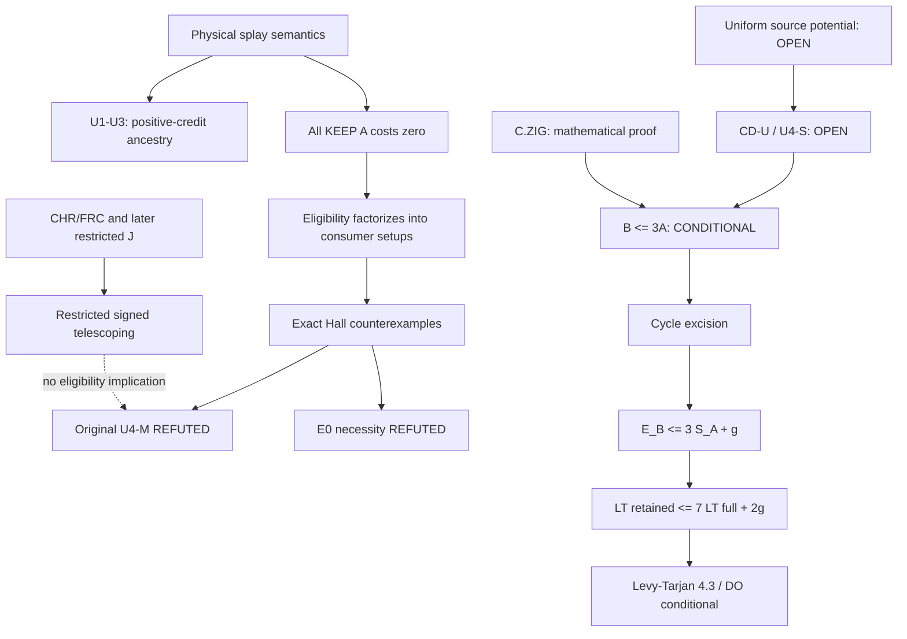

# Proof dependency DAG and conditional downstream assembly

No edge from R or EN proves CD-U false. U4-M=>CD-U remains a valid sufficient implication
with a FALSE antecedent as a universal strategy; U4-S iff CD-U remains the scalar identity.

C.ZIG: cyclically partition accesses into a positive-A-cost leader and subsequent A-root
noops. Every later access in a block has the leader's key. At most one KEEP in the block
can have a B zig, whether the leader is KEEP or DELETE. Charge it to a leader StepEv;
blocks are disjoint. All-A-zero closed walks have no B work. Hence Z_B<=A universally.
[DO_RESEARCH_REBOOT/02_PROVED/C_ZIG_RECONSTRUCTED.md](<C:/Users/Saif malik/OneDrive/Documents/Desktop/Temp/splay-multiscale-transfer-liquidity-k6c2/DO_RESEARCH_REBOOT/02_PROVED/C_ZIG_RECONSTRUCTED.md>) gives the full run proof; formal assembly separate.

If CD-U were proved, B=Q+Z<=3A. For fixed n the reachable pair graph has at most Cat_n^2
vertices. Every edge reward b-3a<=floor(n/2). Removing repeated-state nonpositive closed
subwalks bounds any prefix by g(T0)=(Cat_n^2-1)floor(n/2), or the smaller source maximum
over reachable simple paths. This proves the cycle-excision implication; its cycle premise
remains open. Empty/single-key domains are trivial.

LT translation: d+1<=2ceil(d/2)+1 and ceil(d/2)<=d+1, so LT(Y)<=2E_B+|Y|,
S_A<=LT(X), and |Y|<=|X|<=LT(X). A universal E_B<=3S_A+g gives
LT(Y,T0)<=7LT(X,T0)+2g(T0), with the same initial T0.

Levy-Tarjan v3 Theorem4.3 states that eventual monotonicity of Splay suffices for dynamic
optimality, using their repeatability/coercibility and specified-tree execution model.
The primary [paper](https://arxiv.org/html/1907.06310v3#S4) was checked directly; no final
numeric DO competitive factor is inferred from7 alone. Full proof/kernel assembly gates
remain in [DO_RESEARCH_REBOOT/12_FINAL_PROOF/ASSEMBLY_CHECKLIST.md](<C:/Users/Saif malik/OneDrive/Documents/Desktop/Temp/splay-multiscale-transfer-liquidity-k6c2/DO_RESEARCH_REBOOT/12_FINAL_PROOF/ASSEMBLY_CHECKLIST.md>).
