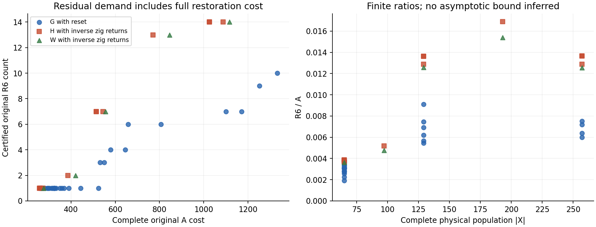

# IAGS 1.2 — EXP-01: physical residual discovery

Date: 2026-11-10, Asia/Karachi. Execute EXP-01 only.

**Final classification: NEW QUANTITATIVE THEOREM — restricted return-normalized scan class.**

The new inequality proved below is

\[
R_{6,\mathrm{return}}(W)\le 3C_{\mathrm{seq}}\mathcal E_{\mathrm{return}}(W)
\le 6C_{\mathrm{seq}}A(W).
\]

Its class is defined by actual complete B identity excursions, not by successful payment. It is nonempty: the 257-key cheap-interruption control has fourteen original R6 events, all in this class. The proof is symbolic, by this agent, relative to the inherited sequential-access theorem and three-slot lemma. It is not formal or external certification. This is a scoped extension of D5, not a solution of the full residual problem. **The original G witness remains outside the new class, and unrestricted R6=O(A) remains OPEN.**

Two separate discoveries explain why a broader claim would be wrong:

* A complete inverse-zig interruption can make an event R6 without any deep A access or costly reset. All physical states through the renewed receiver can agree with a D5-covered source.
* The tempting injective association of R6 to actual A root-entry StepEv survives the initial 127 sources and then fails on independently chosen W-family controls. The 129-key witness requires load two; the 257-key witness requires load three in that exact incidence model. These are exact refutations of load one and load two, not a proof of unbounded congestion.

## 1. Exact inherited theorem, source model and read scope

Use complete labelled trees A and B on the same fixed finite physical universe X. KEEP splays A then B; DELETE splays A and leaves B unchanged. No key is deleted. An admissible source returns both complete labelled trees to their respective initial trees and has a legal reaching prefix from a common diagonal. Prefix work is excluded from every period budget.

Depth counts edges. A double is one StepEv and two real rotations; a terminal zig is one StepEv and one real rotation. Its accounting companion is virtual. Preserve

\[
A=\sum_t\lceil d_A(x_t)/2\rceil,\quad Q_B=\sum_{t\,\mathrm{KEEP}}\lfloor d_B(x_t)/2\rfloor,
\quad R_A=2A-V_A,\quad D_B=B_1+2B_2+Z_1=P_A-N_A.
\]

The inherited theorem is Q_B <= (32+12 C_seq) A + R6. CD(6) retains its at-most-six-genuine-KEEP scope; unrestricted transfer remains open. Route A is inherited as a size-dependent benchmark, without reopening its external paper. BB-01/BB-02 do not supply a strict residual discount. BB-02 was a completed existing report and was read as such.

Current mathematical passages were read directly in RESEARCH_RULES, RG01, RG04, G0–D6, Routes A/B, CD6-TRANSFER, BB01/BB02, the original Pair Access and S/SET specifications, original Route02/04 reductions, and W/H/repeated-source construction reports. Campaign14's source and final scope and Campaign15's source replay, zero-run theorem and unfinished-seal qualification were inspected. The current files are byte-pinned in [EXP01_INPUT_MANIFEST.json](EXP01_INPUT_MANIFEST.json). This does not claim a new audit of every transitive historical proof or a full reread of every provenance appendix. C15's final integrity seal remains pending; owners are neither rerun nor changed.

Branch coarse-double-branch; HEAD 6d532b2c795c0778f57d8023b23b5fedfc48b010. Existing untracked research is preserved. All new writes are isolated here. The governing request explicitly requires repository artifacts, so repository-recoverable mathematics is not duplicated into Notion. The operating guide and enabled-skill metadata were read; none of those enabled skills applies to this mathematical replay.

Final preservation qualification: IAGS12_GLOBAL_BOUNDARY_REUSE.md was a 2,628-byte ancillary entry when the manifest was captured and grew to a completed concurrent report after the numerical runs. Its current scope/conclusion was inspected after detecting the mismatch; it is not a premise of this oracle or new theorem. The original initial hash and the changed final hash are both retained in EXP01_PRESERVATION.json. All actual mathematical/engine/fixture dependencies in the initial manifest remained unchanged. Concurrent R6_SHARED_LOSS_CONTINUATION_20261110_v001/ and SHARP01_EXACT_2A_CONSERVATION/ outputs appeared and were left untouched; their experiments and conclusions are not attributed to EXP-01.

## 2. Experimental oracle and validation

[exp01_oracle.py](exp01_oracle.py) is a new pointer-tree implementation. It records original actor/operation/StepEv/bit IDs, cases RR/LL/LR/RL/ZIG, complete operation-boundary states, both search paths, each actual primitive's pivot/promoted/middle/external nodes, every deleted/inserted physical edge, SET losses/creations and signed disagreement changes. Physical S labels use exact integer bitsets; A duplicate labels are suppressed as a set. No anonymous ancestor or physical hanger is contracted.

Genuine KEEP support M is computed from actual nontrivial B accesses. The original carrier S is its physical ancestor closure at the designated cut, then every B path is checked against it. I is fixed once as D6's initial S-nonleaf set. S and I are never reselected per event.

The existing immutable tuple/frame engine python/independent/splay.py independently checks both full labelled endpoint trees and StepEv/double counts at every one of the **55,313 source operations**. Its legacy depth+1 cost function is not used. This is a separate implementation operated by the same agent, not an independent person or proof assistant.

The 25 initial gates cover hand LR/RL/RR shapes, zigs, exact H costs/cohorts, W_star's full-Pi exclusion, H_dec's shared decreasing bit, W5's same-hit edge recreation, G's 290 operations and specified residual, its exact receiver/reset, complete closure and D6's fringe lift. Four further source types have explicit disjoint cyclic G0 A-gap certificates in [EXP01_G0_GAP_CERTIFICATES.json](EXP01_G0_GAP_CERTIFICATES.json), including zero-current-A-cost KEEPs paid by earlier actual DELETE work.

Every source checks R_A=2A-V_A, D_B=P_A-N_A and K_B<=A. A second full-snapshot implementation checks the cyclic interval predicate against the change-index oracle on 34 G and 15 W_star candidate whole frames. No mismatch was found. A mismatch would invalidate downstream measurements; none was bypassed.

## 3. Exact original renewal certification

For every fully neutral interior B double, the oracle reconstructs its actual whole frame F, last creation Gamma, preceding removal kappa, and every A snapshot of the complete cyclic Pi=(kappa,producer-post-A]. Negative unrolled timestamps identify previous-period occurrences of the SAME original IDs. They are not prefix donors.

Chosen outputs use bit 0 for RR/LL and bit 1 for LR/RL. Their complete original first hits and full cohorts are reconstructed. Adjacent pairs are taken before any classification; removing an ineligible vertex never creates a new filtered adjacency. Each endpoint's entire birth-to-hit A-acquisition history is checked. Intermediate rooted B labels are checked on the shared lifetime. Beta is the first actual consuming bit deleting an original path edge, including external attachment deletion.

The exhaustive pair classes are E_ctl, R_sep, R_dec, R_mix, R_out, T, R_scan, R_fringe and R6. Parent membership includes its own full Pi and its complete non-singleton receiver. D5 uses cyclic constant-target blocks, extreme-anchored consecutive S ranks and the exact long threshold. D6 uses the single original I, outside-I KEEP barriers, its threshold and actual ancestor closure before initialization. DELETEs and identity KEEPs remain in the source. The oracle never labels a local neutral picture R6 without these tests.

There are no uncertified geometric candidates promoted to numerical R6 in the final table. Finite certification remains subject to implementation error and the stated inherited theorem qualifications.

## 4. G: exact complete source and renewal lifecycle

The source starts common at the right vine on [65], with empty prefix. It is exactly the requested preparation, full marked descent, KEEP 1..31, KEEP 1, KEEP 1..65, KEEP 64..1.

| Part | A cost |
|---|---:|
| DELETE 2..65 | 64 |
| Full descending 65..1 | 64 |
| Early KEEP 1..31 | 30 |
| Reset KEEP 1 at t=161 | 15 |
| Entire closing increasing scan | **86** |
| Entire closing reverse scan | 64 |
| **Complete total** | **323** |

Q_B(G)=156, R6(G)=1, and |W|=290. Thus the previously symbolic C_close is exactly **86**, and 237+C_close=323.

The complete C_132 is {(66,15),(68,7),(72,3),(80,1)}. The specified adjacent pair is rho=(132,(72,3),(80,1)). Its inner output has root 10 and J=[3,17]; its outer output has root 18 and J=[3,33]. Their original RR births are B(72,3,0) and B(80,1,0). Both stay A-unacquired. The physical gap is the direct LEFT edge 18->10; there is no intermediate label.

| Original demand | Whole F | Gamma | Previous cyclic kappa | Chosen J | First hit |
|---|---|---|---|---|---:|
| (72,3) | [3,61] | B(68,7,1) | B(72,4,0), previous period | [3,17] | 132 |
| (80,1) | [3,57] | B(72,3,1) | B(80,2,0), previous period | [3,33] | 132 |
| (132,2) | [3,33] | B(80,1,0) | B(132,3,1), previous period | [11,33] | 140 |

At t=132, the COMPLETE B target path is 2->50->34->18->10->6->4->3. The A path is only 2->3, costing one zig. After the first LL double below 10, beta=B(132,2,0) rotates RIGHT at 18, promoting 10. It deletes (34,18,LEFT), (18,10,LEFT), (10,14,RIGHT), and inserts (34,10,LEFT), (10,18,RIGHT), (18,14,LEFT). The complete middle component rooted at 14, on [11,17], is transported intact. The external ancestors 2,50,34 and all their other components are real physical vertices.

Both bits of parent (132,2) are neutral. Its chosen new output is the complete subtree at 18 on [11,33]. Its original complete receiver is C_140={(66,13),(68,6),(132,2)}. At KEEP 11, the two receiver-adjacent paths are 14->12 and 18->14. They share beta=B(140,1,0); both are T, because the renewed demand (140,1) has chosen [13,17] and singleton receiver C_142={(140,1)}. This is an actual termination in this source, not an invented missing relay edge.

Full physical trees, all middle/external attachments, all original events and complete operation histories are in [EXP01_G_LIFECYCLE.json](EXP01_G_LIFECYCLE.json). The file also records every U vertex, cohort and adjacent pair, not just the highlighted chain.

## 5. A/B differences, reset and restoration audit

The unpaid renewal uses the physical ancestor edge 18->10, a deeper B path than A, and a neutral transport of the [11,17] middle subtree. A does not reproduce that B rotation. Original A has only the actual 2->3 root transition at consumption. There is no separate A event automatically issued for either old output.

The actual endpoint LCA covers make the comparative geometry explicit:

| Post-A boundary | Cover of old [3,17] | Cover of old [3,33] |
|---|---|---|
| t=80, outer birth access | [1,17] at root 17 | [1,33] at root 33 |
| t=97 | [1,17] at root 17 | S at root 33 |
| t=113 | S at root 17 | S at root 17 |
| t=131 | [3,65] at root 3 | [3,65] at root 3 |
| t=132, common hit | S at root 3 | S at root 3 |
| t=160, before reset | [1,17] at root 17 | S at root 31 |
| t=161, reset complete | [2,17] at root 16 | [2,65] at root 30 |

A(97,1,0) and A(113,1,0) are genuine zero-sign root entries; A(132,1,0) and A(140,1,0) are positive original bits. They are plausible historical work associations, not unused receipts. The common hit enlarges both old covers in one event. No actual A rotation anywhere in G creates or removes the B gap tuple (18,10,LEFT): a geometric payment theorem cannot require literal recreation of that B edge in A. The complete original event list verifies this negative statement.

At the early anchor I=[1,64] IS ancestor-closed. The early I window has length 31 against threshold 33; the S threshold is 34. Hence this example fails D6 by short length, rather than by an outside-I ancestor. At consumption the physical exterior frontier is [2,50,34], all in I. A proposed rule that every R6 consumption requires a contemporaneous path-isolation failure is false.

At t=161 both actors have the full LEFT vine on visited [1,31] and separate complete right components on [32,65]. KEEP 1 has depth 30 in each actor: fifteen LL StepEv, thirty actual rotations, no terminal zig. All thirty A bits are positive and all thirty B bits decrease. These are already in the original P_A/D_B budget. This audit does not make any owner vacant or prove a new D1–D6 disjoint image.

The complete upper [32,65] components are carried intact during this lower reset. The old chosen output [11,33] has already been hit at t=140; its old rooted-output lifetime is not still waiting for the reset. Individual edge-tuple return, label retirement, ancestry change and complete-tree closure are different events.

The specified depth-30 reset really costs 15. Its necessity does NOT follow. Section 8 gives a complete counterexample to that inference. No excluded preparation or convenient unclosed cut funds either source.

## 6. Perturbation methods and complete-source validity

The initial bounded grid varies p=1..6 and q=1..3 where population <=257, early scan length 3..127, one/two/four short-scan copies, reset targets 1,2,15,30,32,65, preparation length, explicit DELETE helpers, complete-source repetition, seven designated cyclic cuts, marked warmed periods, actual fringe lifts, and order reversal.

The saved generalized G restrictions are preserved where that theorem is invoked: s>=2, p>=2s, q>=1, 3+2^(2s-1)<=L<=2^(2s+1)-1. Other grid members are explicitly exploratory complete constructions, not purported instances of that lower-witness theorem. Their R6 is recomputed, not inherited.

Physical tail controls add 17 or 63 off-carrier keys without visiting them in B. Additional paid DELETE sweeps visit those private A keys and restore the actual A state. Nested inverse returns have depths 2,5,10,30. Their whole costs and complete labelled closing states are retained. No arbitrary splice is accepted without exact closure.

Full increasing/reverse sweeps close the vine-based constructions. The justification is the actual sorted-prefix induction: after visiting 1..k the visited prefix is the full left vine; after a complete increasing sweep the entire tree is a left vine, whose decreasing sweep returns the original right vine. The lifted family uses the saved explicit closing builder, whose actual cost is measured. Warmed and recut sources store and replay their reaching prefixes; those costs are separately excluded rather than reused.

The stages are discovery G/H, controlled variants, feature extraction, and independent falsification by W variants, nested returns/private helpers, reflections and C15 fixtures. No random search was run.

## 7. Complete measurements and growth

All **133** complete sources, exact reduced rational ratios, genuine support sizes and D5/D6 covered counts appear in [EXP01_FULL_MEASUREMENTS.md](EXP01_FULL_MEASUREMENTS.md). The machine-readable [EXP01_RESULTS.json](EXP01_RESULTS.json) adds per-consuming-double R6 events, fixed-I closure changes, physical exterior frontiers, original A work at consumption, source windows, incidence graphs and phase-separated costs. The entire original sums are used in every conclusion.

| Representative complete source | X | A | Q_B | R6 |
|---|---:|---:|---:|---:|
| Original G | 65 | 323 | 156 | 1 |
| G, two short scans | 65 | 390 | 203 | 1 |
| G, four short scans | 65 | 524 | 297 | 1 |
| G_(5,1), L=63 | 129 | 659 | 334 | 6 |
| G_(6,1), L=127 | 257 | 1332 | 679 | 10 |
| H_(4,1) | 65 | 256 | 109 | 0 |
| H_(4,1) + one inverse return | 65 | 258 | 109 | 1 |
| H_(5,1) + one inverse return | 129 | 514 | 231 | 7 |
| H_(6,1) + one inverse return | 257 | 1026 | 459 | 14 |
| W_(5,1) + one inverse return | 129 | 556 | 231 | 7 |
| W_(6,1) + one inverse return | 257 | 1117 | 459 | 14 |
| Nested return, 63 private keys, paid helpers | 128 | 525 | 109 | 1 |
| Full-fringe H_(4,1), two copies + whole builder | 133 | 5662 | 3753 | 0 |

At fixed G size, extra short scans add real A and B work but do not regenerate the original R6 gap: for L=31 the exact increments are A+=67 and Q_B+=47, while R6 stays one. Complete copies of the cheap-return period instead reproduce demand and full cost proportionately: two copies give (516,218,2), four give (1032,436,4).

The maximum measured R6/A is 13/770, attained by DH_(5,2), and the maximum measured Q_B/A is 5/7 in a warmed local scan. Neither is an asymptotic ceiling. R6 counts increase with size in the grid, but no divergent ratio is established. Plot coordinates are floating visualizations of exact stored fractions; they are not numerical proof data.

## 8. New physical construction: an interruption with no deep reset

Start with complete H_(p,q). During its full increasing scan, immediately after KEEP L, insert KEEP L-1; KEEP L. For the basic control p=4,q=1,L=31.

At this boundary each complete tree has the full visited left vine on [1,L], rooted at L, and its own full upper component. L-1 is the actual left child of L and has empty right subtree. The first access is one right zig; the second is its exact inverse left zig. All middle and upper components return to their previous positions. **Both entire trees return**, not merely their roots or labels. The added cost is A=2 and Q_B=0.

The original preparation and descending sweep of H already use only adjacent-key A zigs. The insertion also uses only zigs. Consequently every nonzero A access in DH_(4,1), DH_(5,1) and DH_(6,1) has cost one, despite respective positive R6 counts 1,7,14. The full totals are in Section 7. All original B doubles at retained accesses have the same physical transitions as H.

For the 65-key example, H and DH have EXACTLY the same primitive-event and complete-pair prefix through operation 160, which includes both old births, consumption 132 and receiver 140. The event is R_scan in H and R6 in DH. The later inverse return breaks the original anchored scan before the long threshold. The full Pi predicates pass independently in both sources. Thus even the physical prefix through the renewed receiver cannot determine R6 membership: the ordered-window predicate also depends on later source continuation.

This refutes the precise claims that G-type R6 needs a deep reset, that increasing R6 requires increasing maximum A-access cost, or that an immediate outside-domain failure is necessary. It does NOT refute a whole-source linear A bound. Actual A work remains 4(N-1)+2 for these one-detour H sources.

## 9. Source-defined geometric feature extraction

The useful distinction is between a physical return and an expensive restoration. A verified inverse-zig return is independently detectable from two actual B paths of depth one, zero double cost and exact equality of the complete B states before/after. Nested returns are detected by successively erasing such pairs. Intervening DELETE costs remain in A.

For ONE fixed orientation, use a deterministic left-to-right stack to erase adjacent surviving inverse B zig pairs in the backtrack direction, only when their saved complete B states agree. The original word is never altered. The resulting list is a comparison skeleton over the ORIGINAL S. Detect its maximal extreme-anchored consecutive-S-rank long windows. Their original temporal spans are disjoint for that orientation. A return cannot enclose a surviving window because its interior surviving KEEPs would have prevented erasure.

Define E_return as |S| times the number of these long windows. This is a physical and ordered-word quantity, computed without R6, demand counts, matching or payment. Fix the orientation before forming the class; either orientation has the theorem below. For a deterministic all-source version one may choose increasing when the initial B root is in the lower half of S, decreasing otherwise. The experiment stores both orientations separately and never adds their budgets under a single coefficient six.

Define R6_return as ORIGINAL R6 gaps whose original consuming KEEP is in those skeleton windows. Erased returns contain zero B doubles and therefore cannot consume such a gap. The original Pi, cohort, birth, beta and owner records are NOT recomputed in a putative erased auxiliary source.

## 10. New scoped theorem and complete global cost proof

**Objects.** An arbitrary original admissible complete physical source W, its original S and cut, one fixed orientation, the deterministic physical-return erasures above, E_return and R6_return.

**Hypotheses.** Each erased pair is a genuine complete B identity with zero doubles; nesting is checked before deleting an outer pair. Windows start at the appropriate S extreme and contain ell>=ceil(|S|/2)+1 consecutive distinct S ranks. Identity target repeats are allowed. A performs every original operation, including erased KEEP A phases and all DELETEs. No closure of an episode or A identity of an erased excursion is assumed.

**Conclusion.** R6_return <= 3 C_seq E_return <= 6 C_seq A, uniformly in physical population, source length, private ancestry, hanger sizes, erasure nesting and repetitions.

**Proof.** Erase only for the B comparison. Every deleted block returns the COMPLETE B tree and has Q_B=0. Induction therefore gives the same actual pre/post B states, path depths and doubles at each retained KEEP. S stays the original physical carrier; its off-S subtrees are carried intact. No erased A operation is made free.

A skeleton window is consequently an actual sorted extreme-anchored prefix on the same |S| physical operand tree, from its actual initialization. The inherited sequential-access theorem gives Q(window)<=C_seq |S|. Its mathematical continuation is a comparison, not extra source work.

Every original R6 gap assigned to this window is consumed by one of its retained doubles. The original three-old-path-slot lemma bounds the number of such gaps at each original double by three, independently of erasures. Hence R6(window)<=3Q(window)<=3C_seq |S|.

For each internal transition between distinct consecutive skeleton blocks, take the original A interval after the preceding block's last retained post-A boundary through the next block's first post-A boundary. It contains every intervening original DELETE and erased KEEP A phase. Its endpoint A roots are two different targets. There must be a nonzero original A StepEv. Choose the first one; bit 0 is real even for a terminal zig.

These intervals are disjoint between successive skeleton transitions and between the disjoint windows of the FIXED orientation. Thus their selected original StepEv are globally distinct. In total sum(ell-1)<=A. The threshold gives |S|<=2(ell-1) for each window, so E_return<=2A. Summing the first inequality proves the stated bound. No owner vacancy or independence from D1–D6 images is claimed; the scalar coefficient pays for any overlap. Empty/singleton carriers have no qualifying window or R6 double. The argument is unaffected by source cuts or private A helpers because it uses actual original intervals. QED, relative to the inherited two mathematical inputs.

**Net proof advancement.** For the specified source-defined partition R6=R6_return+R6_other, the inherited theorem becomes Q_B <= (32+18 C_seq) A + R6_other. The new class is nonempty and can contain all fourteen R6 events in the tested 257-key DH source. Original G has R6_return=0 and R6_other=1. No claim that every R6 event has a return-normalized scan is made.

## 11. A-event incidence, exact matching and congestion

Demand-resource edges have a physical reason: an old outer chosen output starts its shared life with A rooted outside J_+, and the common hit ends with A rooted inside J_-. An admissible resource is an ACTUAL global A root-entry rotation from outside J_+ to inside J_+ during that shared lifetime. Its ORIGINAL StepEv is the cost-one resource; two bits of that StepEv are not duplicated as separate resources. Later events with no such transition are not connected.

For original R6 and separately for all blind gaps the program records all these edges, maximum load of the lexicographically first original-ID entry selector, exact unit-capacity maximum matching and Hall deficiencies. That diagnostic selector is not claimed to be first on a cyclic causal lift. [EXP01_INCIDENCE_CERTIFICATES.json](EXP01_INCIDENCE_CERTIFICATES.json) adds exact rational fractional flows and tight Hall sets. Integer max-flow with rational scaling proves the finite optimal maximum load. Connected shared-resource components, rather than unrelated later work, explain the deficiencies.

Initially all 127 R6 graphs admit unit-capacity matching. Treating that as a universal law would be a mistake. The separately generated detour-W family gives:

| Complete source | R6 | Unit matching deficiency | Minimum fractional maximum load |
|---|---:|---:|---:|
| DW_(4,1) | 1 | 0 | 1 |
| DW_(5,1) | 7 | 2 | 2 |
| DW_(5,2) | 13 | 4 | 2 |
| DW_(6,1) | 14 | 5 | 3 |

In DW_(5,1), the two ORIGINAL R6 demands (163,(136,7),(144,3)) and (163,(144,3),(160,1)) both have ONLY resource A(163,13) in this physically justified graph. Their two-demand/one-resource Hall set refutes injectivity. Another shared pair occurs at KEEP 35, t=197. The source is the complete common right-vine 129-key W_(5,1), with inverse KEEP 30;KEEP 31 inserted after its KEEP 31; it has 419 operations, A=556 and Q_B=231. Its entire initial state, tagged word, closing states, original predicates and flow certificate are saved.

DW_(6,1) has a three-demand/one-resource obstruction, rejecting a universal load-two rule. The observed growth does not prove that every fixed load fails. Nor does the counterexample reject payment by the WHOLE expensive A access, other original work, signed budgets or aggregate restoration batches. Exact flow feasibility is a finite certificate only, not a universal theorem.

## 12. Tested restoration, boundary and comparative-geometry hypotheses

| Proposed explanation | Discriminating evidence | Result |
|---|---|---|
| R6 requires a deep interruption/reset | DH has positive R6 and max nonzero A cost one; same renewal prefix as H | Refuted |
| Every R6 consumes outside the fixed ancestor-closed I | G's early I window is isolated; failure is its short length | Refuted |
| Each gap can use a distinct actual A root-entry StepEv | DW_(5,1) two-to-one Hall obstruction | Refuted |
| Load two suffices for that same incidence rule | DW_(6,1) exact fractional optimum three | Refuted |
| Every physical edge recreation needs intervening A work | Original W5 edge 10->6 returns within one B hit | Inherited obstruction independently reproduced |
| Repeating a short G scan repeats its old R6 | r=1,2,4 retains R6=1 while full A grows | Refuted on that family |
| All R6 is recovered by inverse-zig normalization | G's original event stays outside recovered windows | Refuted |
| Long scans after verified zero-double returns have a global original A budget | Nested returns, reflections, private tails, DELETE helper loops; proof in Section 10 | Survives, scoped theorem |

Raw B boundary turnover is not treated as A payment. Fixed-I closure changes and outside-I bit counts are diagnostic inventories. Same-event root entries are not multiplied by cohort size. Complete A/B edge disagreement is available at all G snapshots but no general primitive potential based on it is proposed: neither a summable signed correction nor a residual discount was discovered. The corrected P_A-N_A identity is retained exactly and not interpreted as unused donor capacity.

## 13. Mandatory adversarial controls and completeness limits

* Original G and generalized G: exact source, full reset and restoration measured. R6 is recomputed for every parameter; it is not constant across the family.
* Complete H_pq and H_(6,1): selected full cohorts agree with the saved formulas. The actual growing relay [11,33]->[19,129] is reconstructed in [EXP01_THEOREM_CERTIFICATES.json](EXP01_THEOREM_CERTIFICATES.json), rejecting size-decrease intuition.
* W_pq, W_hit and W5: complete costs are retained. W5 reproduces the physical edge 10->6 at B(41,2,1) without intervening A work. No edge tuple is equated with restoration of its old descendant set.
* W_star: A=282; (72,3) fails full Pi because of A(36,7,1). The original actual C_173 contains only (34,7),(76,1); their intermediate [3,9] separator puts the pair in R_sep. No filtered cohort is used.
* I^mZ for m=2,4,8: all 21 keys and the entire builder remain; the selected renewal has a singleton receiver. It is not falsely inserted as a left R6 gap.
* Warmed marked periods: actual carriers are recomputed. For p=4,q=1, three repeated warmed periods have A=90,Q_B=12, |S|=5 and R6=0. No large excluded first wave is reimported.
* D6 full-fringe lifted H: populations 37,69,133, r=2,3, with all physical keys genuinely accessed by the builder. The p=4 examples have R_fringe=2,3 respectively and R6=0. Whole-builder costs are substantial and included.
* Campaign15 owner and zero-run fixtures, r=7,8 and reflections: complete integer-node instances with all symbolic F gaps empty reproduce A/Q totals 90/58, 102/66, 90/58,107/68. Their R6=0 is a measured control, not a new all-gap theorem. Original owner maps, the real six-key certificates and the unfinished integrity seal are untouched. Arbitrary symbolic gap fillings are not computationally exhausted.

## 14. Surviving physical invariant and E2 decision

The surviving quantity is E_return. Its definition does not count R6, and E_return<=2A has a complete direct original-root-transition proof. It controls a real new residual subclass. It is not a potential chosen to fit the target inequality.

It is NOT known to cover the physical high-cost return in original G or arbitrary nonidentity interruptions. No experiment identifies a universal restoration batch with a proved A budget for that complement. An arbitrary rank jump is never used as a depth lower bound.

Targeted E2 is **not executed**. The useful quantity discovered here already has a direct scoped A bound; there is no supported strict-discount mechanism for the remaining nonreturn class. Erasing genuine KEEP targets would change B's recurrent state and carrier, and no frontier identity is presumed to survive. BB-01's abstract bootstrap is not rerun.

## 15. Strongest deductions and failed generalizations

1. Literal scan eligibility can be destroyed by a complete physical identity costing two A zigs and zero B doubles. Thus R6 classification has a dependence on future ordered-window continuation that is absent from the local renewal geometry. This is certified by identical full prefixes through t=160 in H and DH.
2. Reversible interruptions can be removed for a B comparison without altering original R6 definitions, provided every removed block has zero doubles and restores the full B state. Actual original A intervals, not comparison A costs, pay for the operand population.
3. A globally necessary root-entry association can still have a Hall deficiency on genuine R6. The separation between H-derived discovery cases and W-derived falsification cases matters: the apparently injective empirical law was rejected instead of silently relaxed.

No general boundary law, monotone output-size law, universal root-entry capacity or all-source normalized-scan cover survives these controls. The finite ratio maximum is not a universal coefficient.

## 16. Theorem candidate and THEOREM DISCOVERY LEDGER

Only ONE positive candidate is retained; it is proved at the scoped, same-agent symbolic level in Section 10.

**Candidate: return-normalized sequential windows.** Objects: original R6_return, original fixed S, complete B return excursions, E_return and disjoint original A StepEv intervals. Hypotheses and precise inequality: Section 10. Observed evidence: all 133 sources have exact erasure/trace and budget certificates; source sizes up to 257, nested returns through depth 30, private populations and paid helpers. Strongest independent falsification: DW_(6,1) defeats the local root-entry rule but its fourteen R6 events are still controlled by the whole normalized window; the private-tail/helper reflection also passes. Known limit: original G is not covered. Proof mechanism: exact complete-state B return, classical sorted comparison and globally disjoint ORIGINAL A root changes. First missing lemma for this theorem: none beyond its explicitly inherited sequential-access and three-slot inputs. First missing lemma for a broader result: a genuinely different, independently bounded structure for nonidentity interruptions; the data do not provide it. Universal relevance: deletes R6_return from the remaining obligation at an additional coefficient 6 C_seq, without claiming R6_other is easier by notation alone.

| Candidate | Exact source quantity | Observed relationship | Strongest adversarial test | First proof obligation |
|---|---|---|---|---|
| Return-normalized scan theorem | E_return=|S| times disjoint long normalized windows; R6_return only on their original consumers | R6_return<=3 C_seq E_return<=6 C_seq A, symbolically proved | W-derived detours; nested returns, private tails, paid helpers and reflection | None for stated scope; inherited sequential theorem/three-slot qualifications remain |
| Injective original root-entry association | All actual outside-to-inside root-entry A StepEv in each R6 shared life | Passed initial 127, fails next independent controls | DW_(5,1): two demands/one StepEv; DW_(6,1): load three | Refuted at load one/two; no universal replacement retained |
| Deep reset/restoration necessity | Maximum A access cost; actual reset paths | Positive R6 with every nonzero A access a zig | DH_(6,1): 14 R6, max A cost one, complete closure | Refuted; cannot be a universal lemma |

## 17. Verification qualifications and proof-debt discipline

All numerical counts are exact integers and all ratios exact fractions. Every accepted source has complete labelled closure and explicit reachability provenance. Two transition implementations agree at every source operation; full-Pi snapshot checks and event-edge differences provide further independent checks of implementation interfaces. These facts establish finite reproducibility, not universal empirical proof.

The new scoped theorem has a written global cost argument. It relies on D4's established three-slot theorem and the same classical sequential-access dependency as D5/D6, with no invented numerical C_seq. No formal proof assistant, external auditor or exhaustive all-source computation is claimed. Main Q_B <= constant A, unrestricted R6<=constant A, Dynamic Optimality, CD(7) and strict erasure discounts remain open. No historical proof or owner was promoted, fixed or reallocated.

The one-to-one R6 root-entry conjecture was explicitly falsified after independent controls were added; load two was then separately falsified. It was not retained under a renamed unspecified constant. The new normalized-scan result is a real restricted subclass removal; it is not presented as global completion.

## 18. Computational reproducibility and resource records

See [EXP01_REPRODUCTION.md](EXP01_REPRODUCTION.md). The deterministic pipeline uses isolated scripts, standard-library exact arithmetic and the existing immutable tuple engine. Matplotlib creates the standalone scientific figure; no dependency is installed. All Python invocations use -B and the plot cache stays inside this folder.

There are 133 accepted sources and 55,313 independently checked source operations, plus 133 theorem-interface trace replays and targeted validation/G0 checks. Recorded timed Python CPU is about **168 seconds**, below the self-imposed 600-second bound. The main run is 84.578125 CPU seconds; supplement 73.46875; independent adversarial expansion 5.90625; incidence and final analysis are separately itemized. Exact values and per-stage elapsed time are in [EXP01_RESOURCE_RECORD.json](EXP01_RESOURCE_RECORD.json). One initial validation invocation and two exploratory reporting probes preceded instrumentation; their exact process CPU was not recorded, so the instrumented sum is not falsely called total campaign CPU. Shell reads and authoring time are also outside that numerical CPU sum. No historical cap is reset or borrowed.

The final corpus has maximum X=257, fewer than 200 sources and fewer than 20,000 operations per source. There is no random seed because there is no randomized search. Initial fixtures, whole tagged words, exact closing states, costs, R6 certificates, prefix provenance and canonical primitive hashes are in [EXP01_SOURCE_WITNESSES.json](EXP01_SOURCE_WITNESSES.json). Every long trace can be reconstructed by exp01_inspect.py; G's full trace is already materialized. No compressed trace is used as a substitute for the missing full-Pi predicate.

## 19. Final recommendation and verdict

**NEW QUANTITATIVE THEOREM — RESTRICTED DOMAIN.** Adopt the proved return-normalized window inequality as an explicitly additional subclass bound. Keep the literal original R6 counts in historical accounting; do not retroactively redefine them.

The next useful research object is the nonidentity interrupted progression, beginning with original G, after verified zero-double return excursions have been accounted for. Study its actual A restoration batches and all work within a shared expensive access, rather than assigning one root-entry StepEv per history. The present experiments do not supply a universal batch law, and a new investigation would need its own concrete smaller proof obligation.

The exact G reset cost is 15 and its complete closing cost is 86; neither is a universal necessity. The complete cheap-return and detour-W witnesses explain two tempting false payment principles. R6_other remains open. EXP-01 stops here; E2, CD(7), general potential switching and further campaigns are not executed.
