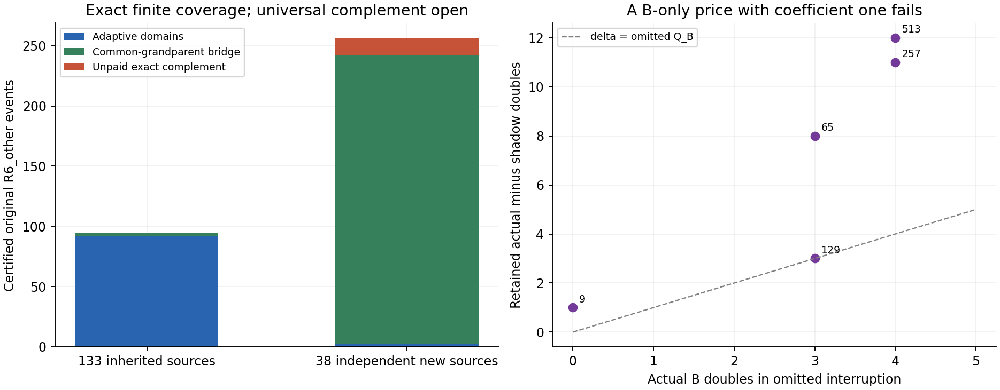

# IAGS 1.2 — EXP-02: final residual closure investigation

Date: 2026-11-10, Asia/Karachi. Execute EXP-02 only.

**Verdict: SUBSTANTIVE PARTIAL QUANTITATIVE PASS. The complete final residual is NOT closed.**

Two new source-uniform comparisons pay adaptive-domain consumers and a broader class identified by common physical double grandparents or synchronized omitted paths. Their union satisfies

\[
R_{\mathrm{adaptive}}+R_{\mathrm{bridge}}
\le (12C_{\mathrm{seq}}+3)A.
\]

They cover all 95 events in the pinned EXP-01 complement on the inherited 133-source corpus. Independent falsification adds 38 complete sources; 14 genuine original residual events in eight of them remain outside the proved cover. Thus finite corpus coverage does not establish FINAL-RESIDUAL. The exact remaining obstruction includes a complete 65-key source whose first hit is an omitted KEEP 5, with A=259, Q_B=110 and R6_other=1.

## 1. Exact inherited scopes and immutable source

Keep the complete labelled physical trees A,B on the same finite X. A splays every KEEP and DELETE; B splays KEEP only. DELETE removes no key. Each complete tree returns to its individual starting tree, and that pair is legally reachable from an allowed diagonal. Prefix work is excluded. Real IDs remain actor/original-operation/StepEv/bit. A double is one cost-one StepEv with two real rotations; a terminal zig is one real bit plus a virtual companion which is never a physical resource.

Preserve A=sum ceil(depth_A/2), Q_B=sum_KEEP floor(depth_B/2), R_A=2A-V_A and D_B=B_1+2B_2+Z_1=P_A-N_A. Actual original signed identities pass every replay.

D5 pays its original long S-ranked scans. D6 adds physically isolated scans on ONE fixed initial nonleaf domain I. EXP-01 adds long scans obtained by its deterministic complete-B-return, zero-double normalization. Their inherited baseline is

\[
Q_B\le (32+18C_{\mathrm{seq}})A+R_{6,\mathrm{other}}.
\]

The sequential-access theorem and original three-slot lemma retain their inherited mathematical verification qualifications. No numerical C_seq or new external audit is invented. The new universal arguments below are same-agent symbolic proofs, not proof-assistant or external certification. The unrestricted coefficient-two problem, CD(7), BB-01/02, and potential-switching campaigns were not executed.

Current EXP-01 engines, tests, reports, source/cost/witness/certificate data and relevant G0–D6/RG/Route B passages were read or reused from unchanged current files in this same session. Original Pair Access and S/SET specifications were reread. [EXP02_INPUT_MANIFEST.json](EXP02_INPUT_MANIFEST.json) pins the actual experiment dependencies; final preservation checks also check original specification and immutable engine hashes against EXP-01's inherited manifest. No historical file, source word, event ID, owner map, branch or Git history was changed.

## 2. Exact authoritative residual and orientation pin

All original R6 predicates are recomputed with the unchanged EXP-01 oracle: full cyclic Pi, complete cohorts before adjacency, chosen births, both endpoint acquisition histories, physical intermediate labels, first changing bit, its fully neutral U_int parent and non-singleton original receiver, and the exact D5/D6 failures.

EXP-01 stored certificates for BOTH normalization orientations, while its coefficient-six proof spends only ONE orientation. Its report supplied an original-root/rank rule but did not store a chosen-orientation field per source. EXP-02 makes that published rule operational: increasing when the initial B root has zero-based S rank r with 2r<|S|; decreasing otherwise; increasing for an empty carrier. It selects the corresponding EXISTING EXP-01 certificate. No two-direction union is charged at coefficient six.

Under this explicit pin the inherited corpus has 239 original R6 events, 144 return-covered events and **95 exact R6_other events**. The maximum-over-directions count would be 146; that alternative is not used. The two additional cut-source events remain in the complement and are paid by the adaptive theorem below. Historical EXP-01 results are not rewritten.

For every source, R6_other is literally the original R6 event set minus the selected return-covered event set. It is never defined by failure to find an A donor. Original G's rho=(132,(72,3),(80,1)) appears in it as required.

## 3. Complete source-level inventory and taxonomy

All 133 inherited sources were independently replayed again, totaling 55,313 original operations, with every saved primitive trace hash matched. Their original costs, closed states, carriers and R6 counts agree exactly with EXP-01. New constructions are independently replayed too; the final corpus has **171 complete sources and 76,474 source operation occurrences**.

[EXP02_REMAINING_R6_INVENTORY.json](EXP02_REMAINING_R6_INVENTORY.json) records every exact complement event, including full endpoint/parent predicates, complete original first-hit and receiver cohorts, physical consuming path, complete A/B birth and receiver snapshots, D5/D6 failures, the selected EXP-01 normalization failure, maximal monotone fragments, following interruption transitions and actual shared-life A StepEv/sign inventories. Complete pre/post original A/B operation states are referenced through [EXP02_ORIGINAL_STATES](EXP02_ORIGINAL_STATES), with content hashes and explicit namespaces. Available A events are NOT asserted to be unused payments.

Overlapping diagnostic labels distinguish short length, missing anchor/rank, fixed-domain isolation/barrier failures, return-normalization failure, and adaptive selection rejection. The final disjoint certificate taxonomy uses source-defined predicates in this order: adaptive covered; retained with a common shadow grandparent; omitted with synchronized original A/B paths; retained without such a shadow grandparent; unsynchronized omitted consumer; outside any eligible shadow window. This is an exhaustive operational partition, not a claimed universal characterization by one physical mechanism.

| Final class, all 171 sources | Original R6_other events |
|---|---:|
| Adaptive-domain paid | 94 |
| Retained common-grandparent paid | 243 |
| Synchronized omitted paid | 0 |
| Retained, no matching shadow grandparent | 4 |
| Omitted, unsynchronized first hit | 10 |
| Outside shadow cover | 0 in this finite corpus |
| **Total** | **351** |

The synchronized-omission rule is proved even though it happens not to supply an additional original R6 event in this corpus. Its role includes paying positive-cost return blocks without assuming their B rotations are free.

## 4. G's mandatory adaptive-domain verdict

Immediately before original G's early KEEP 1..31 (operations 130..160), take the actual complete B. The exact union of all 31 initial target paths is

\[
J=\{1,2,\ldots,32,34,50\},\qquad |J|=34.
\]

The required threshold is ceil(34/2)+1=18, so ell=31 passes. This is distinct from D6's fixed |I|=64 and threshold 33. No ancestor was dropped: 32,34,50 are actual exterior path operands. Keys outside J remain complete physical fringe subtrees.

All targets 1..31 are consecutive initial J ranks, start at min J=1, and every actual primitive keeps J ancestor-closed. Every pivot/promoted/external parent lies in J; complete outside components preserve their internal child pointers. There is no intervening off-window KEEP. The original consumer132 lies inside the eligible window. Its actual B double cost over that window is 25. All initial paths, complete starting/ending B trees, original primitive IDs and the corrected peak-memory measurement are in [EXP02_G_ADAPTIVE_GATE.json](EXP02_G_ADAPTIVE_GATE.json).

**G passes.** This calculation does not assume other G members pass. The L=3 versions fail: their early three-target window has |J|=9 and threshold 6.

## 5. General adaptive eligibility and physical comparison

For each contiguous actual KEEP-block candidate and each orientation, compute J as the union of INITIAL full B root-to-target paths. The accepted window fixes that set for its entire life. The union is initially ancestor-closed, but this fact alone is insufficient: the algorithm separately tests the extreme anchor, genuinely consecutive J ranks and ell>=ceil(|J|/2)+1. Every intervening KEEP is retained; DELETEs are original A work and B identities. Actual target repeats stay in their constant blocks.

Once these tests pass, isolation follows by literal rotation induction. Initially every ancestor of a J target belongs to J. Rotating on J vertices preserves that property. Every complementary component is J-free and is transported intact by actual external/pivot/middle attachment changes. Thus target paths, grouping into doubles/zigs and physical operand edges are exactly those of an ordinary |J|-vertex tree. Complementary components may contain original S keys; original full-S signs/Pi predicates are never recomputed on J.

The accepted ordered prefix has Q_B(window)<=C_seq |J| by the inherited sequential-access theorem from its actual initial tree. The unperformed mathematical completion is only a comparison, not original source work or A credit.

Deterministic selection is chronological on cyclic constant-target blocks: start at the earliest eligible block; take the longest eligible prefix, with an explicit direction tie break; advance past its entire owned window; make one lap. Every new initialization uses its actual full B state. Truncation at the selected cyclic seam is explicit. Rejected consumers remain in the inventory, including those in a candidate rejected by the selection. No R6 count or successful-payment test selects a window.

## 6. Global original A-cost and overlap proof

For an accepted adaptive window with ell distinct blocks, each internal transition has an original A interval from the preceding block's last post-A boundary through the next block's first post-A boundary. The roots at those endpoints are different targets. The interval includes all original helpers and contains a nonzero original A StepEv; select its first real bit0.

Selected windows own disjoint original temporal spans. Their internal transition intervals are pairwise disjoint, including across the original source seam on a single causal lift. Hence each selected StepEv is an ORIGINAL cost-one event used at most once within this budget. No second copy of a cyclic event is issued. The threshold implies |J|<=2(ell-1), giving

\[
\sum_\omega|J_\omega|\le2\sum_\omega(\ell_\omega-1)\le2A.
\]

Each original R6_other gap consumed in the adaptive union uses one original double, which has at most three original gap preimages. Therefore, uniformly over all admissible sources,

\[
\boxed{R_{\mathrm{adaptive}}\le3C_{\mathrm{seq}}\sum|J_\omega|\le6C_{\mathrm{seq}}A.}
\]

Changing J between disjoint windows does not reuse a root-transition interval. The proof licenses these selected adaptive windows; it does not apply D6's fixed-domain theorem to arbitrary overlapping domains. A events may already be counted in inherited scalar budgets; the added coefficient handles that overlap without declaring owners vacant.

On the inherited corpus, this theorem pays 92 of the 95 complement events. Only G_(4,1), L=3, r=1,2,4 remain at this stage. The investigation continued to interruptions rather than treating that partial success as closure.

## 7. Actual versus shadow measurements and source ownership

For one fixed inherited orientation, the canonical shadow rule starts at the earliest appropriate extreme, retains the first subsequent expected S-rank occurrences, and owns a maximal long prefix and its full intervening original span. Other original KEEPs in that span are marked omitted. Selected spans are disjoint. The shadow's fixed J is the union of initial physical paths to its retained targets, and its own extreme/rank/threshold/isolation tests are verified. Original A executes every operation and is never replaced by a shadow A.

An initial four-source pilot allowing either orientation chose the marked descending maximum and omitted the early residual consumer. It was rejected as a coverage rule, not called a payment success. [EXP02_SHADOW_RULE_RECORD.md](EXP02_SHADOW_RULE_RECORD.md) records that pilot and the fixed one-orientation rule before the main distortion corpus. No later weights are fitted to make delta small.

For every retained operation, actual and shadow full B states before/after, target paths, exact double counts, changed physical edges and outside-J actual path nodes are stored in separately named namespaces. Complete states are deduplicated by content hash, not discarded. Files in [EXP02_TRAJECTORIES](EXP02_TRAJECTORIES) contain the full state pools and access records. Each shadow access is checked against the existing independent tuple engine. A continuous closing continuation executes the rest of the actual original period in the shadow and separately records signed compensation and whether full B closure occurs. A shadow is not presumed to be an admissible source or to own original A work.

With delta=Q_actual,retained-Q_shadow,retained, the exact candidate comparison is R_retained<=3C_seq sum|J|+3 sum(delta)_+. Consumers in omitted operations remain separately assigned. Domain sizes in these disjoint shadow spans again satisfy sum|J|<=2A through ORIGINAL retained-target root intervals.

## 8. Physical distortion and signed cancellation findings

Three controls separate false shortcut laws from genuine physical comparisons.

**Zero-double nonidentity interruption.** On a common nine-key right vine, use KEEP 1..4; KEEP 3; KEEP 5..9; KEEP 8..1. The whole original source closes, A=17 and Q_B=1. Omit only the extra KEEP3 for the increasing comparison. It is one B zig, so omitted Q_B=0, but retained delta=1. At the next KEEP5, actual path 3->4->5 has one RR double while shadow path 4->5 has only a zig. Therefore delta_+<=c Q_omitted fails for EVERY finite c in this B-double-only price model.

The actual closing continuation has delta_closing=0, and both complete B trajectories close. Thus full closure does not force nonpositive signed retained-plus-closing distortion. A separately saved, actually replayed control converts just that extra KEEP3 to DELETE3: it is a real paired-closed source with the SAME A=17 and Q_B=0. The two alternative sources do not lend donors to one another.

**High-target interruption.** In the 65-key H-derived source, scan 1..3, KEEP65, then 4..65 and the full reverse. A=317,Q_B=120,R6_other=1. The omitted maximum access costs three B doubles, but retained delta is eight. There is no negative closing compensation. Actual A's maximum jump is retained in the full A cost. At sizes129,257,513 the corresponding deltas are 3,11,12 with omitted double costs3,4,4. These data do not show an unbounded distortion/A family or establish any universal A price.

**Positive-cost whole returns.** The L=3 G reset and low rescan eventually return COMPLETE B, although the omitted block contains one double. A/B physical target paths agree inside that block, so its actual B doubles are bounded by its own actual A work. Retained trajectories then agree and delta=0. Repeated short scans retain their full cost; no recurring output receives a second ticket from an old birth.

The original signed SET identity remains valid in every source. It counts decreasing B bits, not all B doubles or differences between two trajectories. Neither its telescoping nor full B closure cancels the positive neutral workload in these comparisons. No unsupported identification of delta with P_A-N_A is made.

## 9. Common physical grandparents: the new bridge theorem

Full physical frame equality was tested first. It pays a real class but rejects ten additional retained demands whose components change. The counting proof reveals that equality of the old physical grandparent is sufficient; demanding equal whole frames was unnecessarily strong. Both the strict diagnostic and the broader certificates are preserved.

**One-access lemma.** In an ordinary bottom-up splay of x, a physical vertex g is the old grandparent of at most one double. In all RR/LL/LR/RL cases, that double demotes g into a subtree excluding x. Remaining rotations of this same x never make g an ancestor again. A terminal zig is not a double. Thus the labelled old grandparents of one access are distinct, and their set size equals its double cost.

**Objects.** After removing the original return class and the selected adaptive class, retain the above fixed disjoint shadow windows. An original gap is in the bridge class if either (a) its actual consuming operation is retained, and the old grandparent of its ORIGINAL consuming double is also an old grandparent of a shadow double at that same retained operation; or (b) its consuming operation is omitted and its complete original A/B target paths are identical. These tests depend on physical source/comparison data, never on finding an A payment.

**Proof for (a).** Map each such original parent double to the shadow double with that same physical grandparent at the same original operation. Existence is the stated physical predicate. Uniqueness and injection follow from the one-access lemma in EACH trajectory; different retained operations use different shadow occurrences. Every original parent has at most three incoming original gaps. Consequently the retained bridge count is <=3 sum Q_shadow<=3C_seq sum|J|<=6C_seq A. The shadow is only a mathematical B comparison. No original full-Pi predicate is replaced by a shadow predicate, and no physical frame or ancestor is contracted.

**Proof for (b).** Identical full original target paths have identical depth, orientation sequence and double grouping, so Q_B(t)<=A(t). Associate an omitted B double(t,j) to the ACTUAL A StepEv(t,j), which exists as a real double and is not a virtual companion. Such own-operation StepEv are distinct across omitted operations. The three-slot bound yields <=3A for this entire omitted class. This is scalar counting, not vacant-owner reassignment.

Adding the two budgets proves the source-uniform theorem

\[
\boxed{R_{\mathrm{bridge}}\le(6C_{\mathrm{seq}}+3)A.}
\]

Internal budget injections are global over the chosen spans. Possible overlap with adaptive root intervals and older D1–D6 scalar images is paid by adding coefficients. Physical components, private ancestors, helpers, terminal zigs and cyclic original IDs remain intact. Empty/singleton/zero-cost sources have no relevant original gaps. The argument does not assert that every difficult grandparent appears in the shadow.

## 10. Physical grandparent distortion identity

Let G_a(t),G_s(t) be the distinct physical old-grandparent sets for one retained original operation in the actual and shadow trajectories. Define l_t=|G_a\G_s| and m_t=|G_s\G_a|. These quantities are independent of R6 counts or payment selection. The one-access lemma gives the exact primitive identity

\[
q_a(t)-q_s(t)=l_t-m_t,\qquad \delta_\omega=L_\omega-M_\omega.
\]

It is verified for every retained operation in [EXP02_GRANDPARENT_DISTORTION.json](EXP02_GRANDPARENT_DISTORTION.json). An additional actual grandparent can support at most three unmatched original gaps. Common grandparents are already counted by the shadow scan. This separates physical new work from the signed cancellation hidden in raw delta.

There is no proved universal A bound for sum L, no proved universal bound on unsynchronized omitted demands, and no proof that all sources have a sufficiently long canonical shadow. Counting a repeated physical key as a fresh A unit is forbidden; l_t refers to an actual double occurrence, not a reusable key ticket. The identity supplies a specific physical audit quantity, not an all-source payment theorem.

## 11. Adversarial failures and the primary exact obstruction

The new tests deliberately put the first inside hit IN an omitted operation, rather than after an interruption. The smallest positive member in the tested dyadic p=3,4,5,6 controls is:

* Start common at the full right vine on [65], with empty prefix.
* DELETE2..65; descend every65..1, keeping exactly65,64,62,58,50.
* KEEP1; KEEP2; **KEEP5**; KEEP3..65; KEEP64..1.

This is 259 original operations, A=259,Q_B=110, with both complete labelled trees closing exactly. Its unique original R6_other is rho=(132,(72,3),(80,1)), now consumed by KEEP5 at132. The full first-hit cohort remains {(66,15),(68,7),(72,3),(80,1)}; no filtered adjacency is used.

Actual A path is 2->3->4->5 (cost2), while actual B path is 2->50->34->18->10->6->4->5 (three doubles and a zig). The first double is LR; the original old gap 18->10 is first changed in B(132,2,0), inside a fully neutral LL parent with frame [3,33]. Its chosen output is [11,33] at18; the complete receiver at141 is {(66,13),(68,6),(132,2)}. All original full cyclic Pi/absence tests pass.

The increasing fragment through this hit has targets1,2,5 and initial path domain {1,2,4,5,6,10,18,34,50}. It has size9 and threshold6, and also FAILS consecutive domain ranks because the real physical ancestor4 was skipped. The subsequent decreasing fragment5,3 fails both extreme and rank requirements. The exhaustive candidate audit finds no eligible adaptive cover of this consumer.

The canonical shadow expects3 after2 and omits KEEP5. Its retained delta is -2, so its positive distortion is zero. The actual source nevertheless has the genuine omitted R6 event. Its A/B paths disagree, so the direct omitted-path rule is unavailable. This refutes the coverage claim that adaptive domains plus retained shadow consumers exhaust the residual. It also shows why proving a bound on positive retained distortion alone would not finish the target.

[EXP02_PRIMARY_OBSTRUCTION.json](EXP02_PRIMARY_OBSTRUCTION.json) preserves the complete source, exact closing states, full original predicates, all consuming B bits, physical states and comparison. The reflected source has the same obstruction. At129/257 keys, two/three such omitted gaps share the same omitted hit; no distinct A-root-entry donor is assumed.

Four further events in repeated whole periods have actual consuming grandparents absent from their chosen shadow accesses. These are separately tagged selection/trajectory failures: the earliest extreme anchor can span a later marked preparation. No claim is made that this greedy rule is an optimal cover. These cases remain explicitly unhandled instead of altering the rule after seeing them.

## 12. Full residual coverage and strongest quantitative interface

The final source-defined partition is R6_other=R_adaptive+R_bridge+R_unhandled. Its newly paid part obeys

\[
R_{\mathrm{adaptive}}+R_{\mathrm{bridge}}\le(12C_{\mathrm{seq}}+3)A.
\]

Combining with the inherited baseline yields only

\[
\boxed{Q_B\le(35+30C_{\mathrm{seq}})A+R_{\mathrm{unhandled}}.}
\]

**This is not unrestricted Universal Relaxed Coarse-Double:** no absolute A bound on R_unhandled has been proved.

| Corpus | R6_other | Adaptive paid | Bridge paid | Explicitly unhandled |
|---|---:|---:|---:|---:|
| 133 inherited sources | 95 | 92 | 3 | 0 |
| 38 independent new sources | 256 | 2 | 240 | 14 |
| **All 171 complete sources** | **351** | **94** | **243** | **14** |

The entire finite inherited complement is paid, but the new sources disprove full coverage by the proposed physical rules. All 14 events retain their original R6_other predicates; ten are omitted first hits and four lack a common shadow grandparent. They are listed individually, with parent IDs and full witnesses, rather than renamed without inspection.

The general distortion ownership formula is also valid: after the adaptive class, assign every original consumer to retained, synchronized omitted, other omitted, or outside the shadow cover. Then R6_other <= (12C_seq+3)A +3 sum(delta)_+ +R_omitted-or-outside. The last term cannot be discarded. Alternatively unmatched retained parents are <=3 sum L, with the same separately preserved omitted/outside term. Neither sum L nor the omitted term receives an unproved universal A price.

## 13. Surviving aggregate structures and exact proof debt

The source-uniform structures that survive are disjoint adaptive path-union domains, disjoint original root-transition intervals, common physical-grandparent occurrences across two B histories, and synchronized original path costs inside omitted returns. Positive-cost whole-return episodes are paid through these structures, not erased as free.

Complete H/W/G, DH/DW, nested returns, private hangers/helpers, fringe lifts, I^mZ, warmed periods, W_star and both C15 owner/zero-run fixtures are retained in the 133-source stage. H's growing renewal relay, W5's within-hit edge recreation, W_star's full-Pi exclusion, and DW's shared-root-entry obstructions are preserved by matching original trace hashes. C15's unfinished historical integrity seal is not upgraded. Newly added wrong-order hits, high-target interruptions, repeated periods, reflections, a513-key control and an actual auxiliary closure control supply independent falsification.

The smallest outstanding physical task exposed here is to pay a shared first-hit cohort when that first hit is omitted from the legitimate sorted comparison, its minimal initial physical domain contains a skipped ancestor, and its actual A path is shorter than B's. The65-key KEEP5 source supplies this exact test. A theorem must use actual source preparation/restoration or an aggregate lifecycle budget, with bounded global event reuse; local root-entry selectors already fail on DW. The present work does not identify that budget.

For retained misses, a stronger deterministic selection might avoid some preparation-spanning windows, but no all-source existence/coverage theorem for such a selection is supplied. Fitting a better finite selection is not a proof. The signed grandparent identity and original P_A-N_A identity likewise have no proved universal comparison tying their remaining terms to distinct A work. These are actual proof debts, not premises assumed for closure.

## 14. Reproducibility, resources and computation corrections

[EXP02_REPRODUCTION.md](EXP02_REPRODUCTION.md) specifies the deterministic pipeline. The original EXP-01 engine is imported unchanged; no replacement complete physical engine, install, solver enumeration or subagent was used. Shadow/frame instrumentation invokes the same physical Tree rotations and is checked against independently certified full states. Matplotlib renders the standalone figure with its cache inside EXP-02.

The canonical corpus has133 inherited plus38 new complete sources, maximum physical population513, and76,474 corpus operation occurrences. There are578 final checks. Timed Python CPU is approximately **593 seconds**, with exact stage values in [EXP02_RESOURCE_RECORD.json](EXP02_RESOURCE_RECORD.json). Maximum recorded process peak working set is982,577,152 bytes, about937 MiB. The stage records distinguish repeated checks from distinct corpus occurrences and separately count shadow accesses. No old resource cap was reset or borrowed.

Computation limitations are explicit: three small diagnostic pilots preceded the timed canonical runs. One finalization attempt completed replay but failed before writing its timer because a local integer shadowed the time module; the affected extraction was corrected and rerun. Its exact CPU was not captured, so the recorded sum is NOT claimed as total campaign CPU. A first untyped Win32 memory probe returned invalid zeros and was corrected before the measured inventory. A syntax-only failed invocation performed no source replay. These failures did not bypass an oracle mismatch or change any source result. Exact wall/memory/CPU values for all successful stages and these omissions are recorded. The self-imposed900-second limit applies to recorded numerical CPU; no claim is made to a precise total including unmetered work.

## 15. Verification limits and provenance

Every accepted original period has complete labelled paired closure and saved reaching provenance; all new sources begin on an allowed common diagonal, so their prefixes are empty. All original A costs include preparation, interruptions, helpers and entire closing scans. Existing warmed/cut prefixes remain separately excluded. Immutable tuple replay checks every source operation, and shadow accesses and closing continuations are independently checked. Cyclic Pi and original classes are inherited from the unchanged validated oracle, not inferred from geometric resemblance.

All arithmetic for counts/ratios is exact integer/rational arithmetic. Figures are visual summaries. Original and shadow namespaces remain distinct; equality of two tree values does not merge their events or budgets. The new proofs rely on classical sequential access and the original three-slot theorem; their external/formal status is unchanged. No numerical experiment establishes a universal assertion merely because all tested rows pass.

All pinned historical inputs remain unchanged. Branch coarse-double-branch and HEAD6d532b2c795c0778f57d8023b23b5fedfc48b010 are preserved; tracked diff is empty. Concurrent unrelated research directories are untouched. The user explicitly requested repository artifacts, so recoverable repository mathematics is not duplicated into Notion.

## 16. Final mathematical verdict

**SUBSTANTIVE PARTIAL QUANTITATIVE PASS.** Adaptive physical domains and the common-grandparent/synchronized-path bridge give the stated absolute-coefficient bound on an exact, genuinely new portion of the original final residual. G is covered by an exact34-vertex domain, and every inherited EXP-01 complement event is covered in the finite corpus.

**COMPLETE FINAL RESIDUAL CLOSURE is not obtained.** Fourteen certified new events survive the proved rules. The primary65-key omitted-first-hit source and the preparation-spanning repeated controls show exactly where the attempted universal cover fails. No C_other, unrestricted relaxed Coarse-Double or Dynamic Optimality conclusion follows. The next proof obligation is the aggregate original A payment for these nonordered first hits and missing-grandparent lifecycles, not another bootstrap or sharp-coefficient problem.
