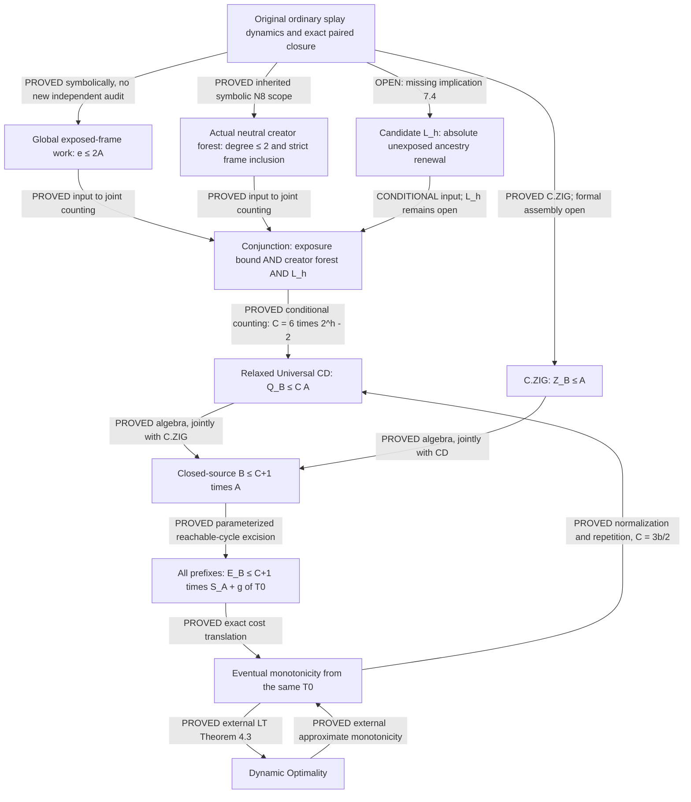

# Route 04 — Relaxed Universal Coarse-Double, discovery Step 01

Date: 2026-11-08, Asia/Karachi. Independent of Routes 01–03.

**OUTCOME X — NO CLOSING MECHANISM ESTABLISHED.**

The existence of an absolute finite C remains **OPEN**. Neither a proof of
Relaxed Universal CD nor a family of closed sources with unbounded Q_B/A
has been obtained. This report does not claim a new partial certification.

The sufficiency gate is completed as a mathematical implication: the original
all-size reachable-cycle premise, for ANY universal C, gives eventual
monotonicity with a universal multiplier and an initial-tree-only overhead.
The exact Levy–Tarjan theorem then gives Dynamic Optimality. A converse is
also proved below by source normalization and repetition. Thus existence of
some C is equivalent to Dynamic Optimality in the audited model; this does
not compare the difficulty of their possible proofs.

There is a useful aggregate simplification: all neutral demands whose whole
frames are A-exposed in their complete preceding-removal windows have bounded
physical-work multiplicity, without any unused-owner premise. If U counts
the other neutral demands, the source-derived bound is

\[
\boxed{Q_B(W)\le 4A(W)+U(W).}
\tag{R04.1}
\]

U has an independent definition in Section 5. It is not defined as a deficit.
Nevertheless, merely asserting U=O(A) would leave an equivalent unproved
burden. A concrete stronger renewal lemma is examined in Section 7, with its
complete finite-C implication established BEFORE its proof attempt. That
attempt stops at a specific unsupported source implication. It is not
promoted to Outcome B just because its conditional arithmetic closes.

## 1. Authority, scope, and evidence

Repository inspected in place:

`C:/Users/Saif malik/OneDrive/Documents/Desktop/Temp/splay-multiscale-transfer-liquidity-k6c2`

Branch: `coarse-double-branch`.
HEAD: `8c378d49283b3738b18e7175886772a98025e4e9`.
The tracked worktree was unchanged on inspection; substantial newer research
is untracked. In particular, the November 8 Route 02 reuse report and Route
03 Step 03 report are available and are used instead of treating the Git
commit as the latest mathematical snapshot. No checkout, commit, branch
change, historical-file edit, or modification of another campaign occurs.
All writes for this task are confined to this new report.

### 1.1 Original source, without a changed model

K is an arbitrary finite ordered PHYSICAL key set. A performs ordinary
bottom-up splay on every KEEP and DELETE request. B performs ordinary
bottom-up splay on KEEP and freezes on DELETE. DELETE never removes a key.

W is a finite legal word starting at a pair reached by an original legal
prefix from an allowed diagonal (T0,T0). Both COMPLETE labeled trees return
exactly to their own starting trees. A need not equal B at that boundary.
The prefix is not included in A(W) or Q_B(W). All genuine KEEP supports,
helpers, private A ancestors, full-B hangers, periods, and cyclic cuts remain
allowed. The recovered original pipeline permits every valid T0 on K.

With edge-depth d, including root-depth zero,

\[
a_t=\lceil d_A(x_t)/2\rceil,\qquad
q_t=\begin{cases}\lfloor d_B(x_t)/2\rfloor&\text{KEEP},\\0&\text{DELETE},\end{cases}
\quad A=\sum_ta_t,\quad Q_B=\sum_tq_t.
\]

On KEEP let z_t=d_B(x_t) mod 2 and b_t=q_t+z_t; both are zero
on DELETE. Put Z_B=Σz_t and B=Σb_t. An A double has two real rotation
bits. An A terminal zig has one real bit and one distinct virtual accounting
bit. Thus there are 2A accounting units and

\[
R_A=2A-V_A
\tag{1.1}
\]

actual real A rotations. No later multiple of A in an inequality is a
collection of new physical bits.

**Zero-cost cases.** If A=0, every request is to the one unchanged A root x.
After the first KEEP x, B is rooted at x and all further B operations are
identities. Exact B closure forces even that first KEEP to have been an
identity, if it exists. Hence Q_B=Z_B=0. Empty words, no-KEEP words, and
the empty physical universe are handled directly; only the empty word is
legal in the latter case. No ratio involving A=0 is formed.

If genuine KEEP support is empty then Q_B=0 independently of A. In a
nontrivial closed B word, every root-repeat KEEP targets a previous genuine
KEEP's root in the same cyclic period. Therefore all KEEP targets equal the
genuine support M. Its fixed labeled B carrier S satisfies

\[
|M|\le |S|\le 2|M|-1.
\tag{1.2}
\]

This is the original closed-core theorem, not physical contraction. B path
operands lie in S; all physical off-S hangers remain present. No comparable
restriction is imposed on A. J_S(T) is the SET of nonempty S-descendant
labels of actual physical subtrees, counting duplicate A labels once.

### 1.2 Inherited results and exact audit qualifications

Paths in this table are relative to `DO_RESEARCH_REBOOT/`. C35 abbreviates
`SE03_STEP3_RECURSIVE_SOURCE_CLOSURE_35/`. The entries distinguish inspected
theorem/audit statements from an independent re-verification, which was
NOT performed.

| Input | Mathematical scope and retained status |
|---|---|
| [Original pipeline](../ORIGINAL_PIPELINE.md), [cycle reduction](../02_PROVED/PIVOT2_CONDITIONAL_REDUCTION.md), [C.ZIG](../02_PROVED/C_ZIG_RECONSTRUCTED.md) | Present-key Pair Access and same-T0 cost interface. Mathematical C.ZIG proof is complete; formal run assembly is open. Cycle-to-prefix is a proved implication conditional on its universal cycle premise. |
| [CD5 proof](../CD5_BASE01/CD5_PROOF.md), its `CD5_CERTIFICATE.json` and `PROOF_AUDIT.md` | Q_B≤2A for genuine support at most five, all physical populations and complete original cycles. Existing computer-assisted symbolic assembly; historical separate implementation checking by the same agent. |
| [CD6 theorem](../SE03_STEP2_CD6_FINAL_ASSEMBLY_14/CD6_THEOREM.md), `CD6_FINAL_CERTIFICATE.json`, `INDEPENDENT_AUDIT.md` | Exactly six genuine keys; with CD5, support at most six. Arbitrary physical populations. No support-uniform extension. Not formal certification or external peer review. |
| [ND35 source/audit](../SE03_STEP3_RECURSIVE_SOURCE_CLOSURE_35/ND35_COMPLEMENT_08/ND35_UNIVERSAL_AUDIT.md), [ZRC35](../SE03_STEP3_RECURSIVE_SOURCE_CLOSURE_35/ND35_COMPLEMENT_08/ZIG_RELEASE_COMPLEMENT_THEOREM.md), saved `independent_audit.json` | Original Ψ, same-period crossing bijection, nonneutral matching, and terminal-neutral completion at RAW scope. Historical same-agent distinct-implementation challenge is recorded. No global internal-neutral, frozen-owner, or Bank25 conclusion. |
| [PC35 exact residual](../SE03_STEP3_RECURSIVE_SOURCE_CLOSURE_35/PC35_RELEASE_COMPLETION_09/STEP1_EXACT_RESIDUAL_IDENTITY.md), its `STEP1_VERDICT.md` | Same-access release completion and exact residual, not global solvency. Existing symbolic proof and historical cached-record checks; no new replay here. |
| C35 `STEP3_1B_NECESSITY_CONTINUATION_01.md` through `_09.md` | C01 persistence/own-work; C02 regeneration and N8 whole-frame forest; C03 blocker sponsorship; C04 shared erosion/retirement; C05–06 preparation/crossing rules; C07–08 acquisition/exception mechanisms; C09 FAR comparison. Statements and relevant proof portions inspected; the complete dependency proofs were not independently reconstructed. New geometry retains symbolic, independent-audit-pending status and its stated predicates. |
| [Route 02 chains](../PARALLEL_SCALAR_INTERNAL_NEUTRAL_STEP01_20261108/PARALLEL_SCALAR_INTERNAL_NEUTRAL_STEP01.md), [global coupling](../PARALLEL_SCALAR_INTERNAL_NEUTRAL_STEP02_20261108/PARALLEL_SCALAR_INTERNAL_NEUTRAL_STEP02_GLOBAL_COUPLING.md) | Nonbranching designated-output chains; cross-access link count ≤2A; producer-child transition count ≤T_A; scan-family work. Restricted mechanisms, not all-source coverage. Symbolic/audit pending. |
| [Attachment Step 1](../PARALLEL_ROUTE02_ATTACHMENT_TRACE_20261108/STEP01_ATTACHMENT_TRACE.md), [latest reuse Step 2](../PARALLEL_ROUTE02_REUSE_RESTRICTION_20261108/STEP02_REUSE_RESTRICTION.md) | Silent attachment/first-hit/post-retirement records; nested exposed-frame work; arbitrary-collection preparation/loss multiplicity at most two; larger preceding-removal windows. This later report still explicitly leaves joint near-side funding and global composition open. |
| [Route 01 latest global-sign continuation](../SE03_STEP3_RECURSIVE_SOURCE_CLOSURE_35/SCALAR_FIRST_BOUNDARY_DEFECT_01/BOUNDARY_DEFECT_CONTINUATION_02_GLOBAL_SIGN.md) | Six guarded odd profiles and guarded rejoin/suppression laws. Universal availability and positive-double-only coverage remain open. Symbolic/audit pending. |
| [Route 03 latest Step 3](../PARALLEL_ROUTE03_CD_INDUCTION_20261108_01/PARALLEL_CD_INDUCTION_STEP03_GLOBAL_REDUCTION.md) | Deep-KEEP and quantitative rewrite invariants; complete fixed-key cover criterion; maximal-core obstruction to packet availability. No universal support induction. Analytic author checking, no new independent audit. |

The requested reports were available. No absent historical result has been
invented. The old literature manifest's different v1 pin/absent L2 issue is
retained: this report uses the recovered actual v3 theorem and live primary
paper, not a claim that the old registry's missing gates were repaired.
Hash agreement would establish byte identity only.

R1 preserves source/theorem scope; R2 actual operations, costs, sorts, and
IDs; R3 historical owners, contracts, resource caps; R4 evidence statuses.
These are the meanings in C33 `SOURCE_INTEGRITY.md`. No owner maps from
different historical normalizations are coinstalled. Pure cost comparisons
below do not alter any physical receipt.

## 2. Sufficiency audit for an arbitrary universal C

Assume the prospective theorem

\[
\exists C<\infty\ \forall W\text{ admissible}: Q_B(W)\le CA(W).
\tag{2.1}
\]

There is no loss in replacing C by max(C,2). The following argument does
not fix a numerical value of C.

### 2.1 Compatible C.ZIG and all reachable cycles

C.ZIG partitions a nonzero-A cycle into blocks beginning with one nontrivial
A access and followed by that same target's A-root repetitions. Each block
has at most one B terminal zig, whether its first request is KEEP or DELETE.
Distinct blocks have distinct leading A events. Thus Z_B≤A. Section 1.1
handles A=0. This proof needs neither a support bound nor a diagonal start.

Consequently, at exactly the source scope of (2.1),

\[
\boxed{B=Q_B+Z_B\le (C+1)A.}
\tag{2.2}
\]

Closed words reached from a PARTICULAR diagonal (T0,T0) are a subset of
the original admissible sources. Therefore (2.2) applies to every cycle
that can be excised from a walk from that diagonal. Restricting (2.1) to
diagonal-start cycles themselves, or to certified small supports, would
not give that premise.

### 2.2 Parameterized cycle-to-prefix proof

Fix K, n=|K|≥1, T0, and β=C+1. The ordinary Pair Access graph has at most
V=Cat_n² complete labeled pair states. Give a legal edge reward

\[
w(e)=b(e)-\beta a(e).
\]

Every reachable closed walk has nonpositive reward by (2.2). When a finite
walk repeats a complete state, remove the intervening closed segment.
Determinism preserves the remaining legal operations and their costs.
The removed segment is reachable by the current retained prefix, so its
reward is nonpositive. Repeating this leaves a simple path of at most V−1
edges and can only increase reward. Since β≥0,

\[
w(e)\le b(e)\le \lfloor n/2\rfloor.
\]

For EVERY finite mask/target prefix H from (T0,T0), therefore,

\[
E_B(H)\le\beta S_A(H)+g(T_0),\qquad
g(T_0)=(\mathrm{Cat}_n^2-1)\lfloor n/2\rfloor.
\tag{2.3}
\]

This is the original excision proof with its coefficient parameterized.
The sharper maximum reachable-simple-path residual is optional. The
displayed bound is finite, integer-valued, independent of the history,
mask, source length, and chosen source. It may grow very rapidly with n.
That growth is allowed ONLY as initial-tree overhead at this stage.
It has not been absorbed into C. For n=1 it is zero; for n=0 the claim is
the empty history. No prefix is asserted closed and no source is charged
for its reaching prefix.

### 2.3 StepEv costs versus splay search/restructuring costs

Let X be the full request sequence of H, Y its occurrence subsequence of
KEEPs, m=|X|, k=|Y|. Define L(X,T0)=Σ(d_A+1), and similarly for Y in B.
These are the recovered LT splay costs. Direct integer arithmetic gives

\[
L(X,T_0)=2S_A+m-V_A,\qquad
L(Y,T_0)=2E_B+k-Z_B.
\tag{2.4}
\]

In particular, S_A≤L(X,T0), k≤m≤L(X,T0), and (2.3) recovers the
original pipeline's parameterized conservative constant

\[
L(Y,T_0)\le (2C+3)L(X,T_0)+2g(T_0).
\tag{2.5}
\]

For C=2 this is exactly its factor 7. In fact 2S_A≤L(X,T0), so the same
proof also gives the harmless stronger factor C+2 in (2.5). Either
multiplier is universal if C is universal. Optimization is unnecessary.
Root requests have zero StepEv cost but LT cost one; the k and m terms
in (2.4) explicitly retain them. One cannot identify these cost models
literally. A primitive search-plus-rotation implementation of splay has
cost 2d+1, between d+1 and 2(d+1), so this translation loses only another
absolute factor if that convention is used.

### 2.4 Exact external input and initialization

External theorem record: Levy–Tarjan, first submitted 2019; the inspected
version is v3, May 9, 2022. Section 2 uses rooted-hull transition cost;
splay costs path nodes, our d+1. Theorem 3.5 equates splay dynamic
optimality with approximate monotonicity from the same specified initial
tree. Section 4 permits a universal multiplier plus any integer overhead
depending only on that tree. Theorem 4.3 converts this eventual monotonicity
to dynamic optimality without startup overhead; its coercibility and
repeatability are supplied by the paper. Appendix A supplies constant-factor
equivalence with rotational execution. These are external results, not new
certifications here. [Primary paper, §§2–4 and Appendix A](https://arxiv.org/html/1907.06310v3).

Equation (2.5) has exactly the required quantifiers. Both executions start
at T0, every Y is an occurrence subsequence of X, and 2g(T0) is tree-only.
Its n dependence is therefore permissible in this application; a
source-dependent or sequence-length-dependent overhead would not be.
The theorem removes this overhead through its own reduction, not by
asserting that every short X already pays it. No O(n) overhead assumption
is needed. A changed initial-tree convention would require a new audit.

**Sufficiency verdict.** At the original all-T0, all-reachable-cycle scope,
there is no additional OPEN downstream mathematical theorem after (2.1)
and compatible C.ZIG. Formal mechanization and independent checking of
the local research proofs remain separate audit tasks. The actual prefix,
monotonicity, and DO conclusions are CONDITIONAL because (2.1) is open.

### 2.5 A separately proved converse: normalize, reach, repeat

This subsection is a symbolic transfer proof; it is not a source run.
Assume eventual monotonicity holds with universal b and tree-only h(T0).
It suffices also to assume the stronger zero-overhead version.

Take any admissible cycle W with A>0. Cut it between two different-target
runs. Replace each maximal consecutive same-target run by one request to
that target: KEEP if the run contains any KEEP, DELETE otherwise. A's
first splay and B's first KEEP are the only possible nonidentities in a
run; they act in separate trees. Thus each replacement has the SAME full
pair endpoint and the SAME A and Q_B costs as its original run. This is
the original repeated-target merger as a scalar proof comparison, not an
edit of an archived source or an occurrence-ID allocator.

The new word W' is legal, reachable from that cut, and exactly paired-closed.
Adjacent targets differ cyclically. Hence every A access is nontrivial,
and its request count m' satisfies m'≤A(W')=A(W). A one-target cyclic
word has Q_B=0 and needs no comparison. Let P be a fixed original legal
prefix from (T0,T0) to W's cut; it reaches W' as well. For each integer
j≥1, the legal diagonal-start history P(W')^j encodes a full X_j and its
retained subsequence Y_j. Complete paired closure gives

\[
\begin{aligned}
L(X_j,T_0)&=L_A(P)+jL_A(W'),\\
L(Y_j,T_0)&=L_B(P)+jL_B(W').
\end{aligned}
\]

Eventual monotonicity, division by j, and j→∞ yield

\[
2Q_B(W)\le L_B(W')\le bL_A(W')
 =b(2A-V_A'+m')\le3bA.
\tag{2.6}
\]

The prefix and h(T0) vanish only in this LIMIT argument; neither is
borrowed as a donor. Thus eventual monotonicity implies Relaxed CD with
C=3b/2. Dynamic optimality supplies approximate monotonicity through the
external characterization just recorded. Combining (2.1)–(2.6),

\[
\boxed{\text{Relaxed Universal CD}\ \Longleftrightarrow\
\text{splay Dynamic Optimality in this model}.}
\tag{2.7}
\]

This does not prove either proposition. It does supply the EXTRA transfer
needed before claiming that a genuine unbounded closed-source ratio would
refute DO. A negative extracted packet, a coefficient-2 violation, or a
failure of one charging rule does not satisfy that premise.

## 3. Relaxed scalar identity and what it changes

Use ONLY the inherited Ψ=|J_S(B)\J_S(A)|. Let P,N,T_A count real A
rotations of signs +1,−1,0. During B's phase, A is rooted at its target;
each real B rotation has Ψ change zero or −1. Let B_i count doubles with
total decrease i, and Z_1 decreasing B terminal zigs. Every actual final
B single rotation decreases Ψ, so Z_1=Z_B here. Closure and the physical
unit partition give

\[
2A=P+N+T_A+V_A,\qquad
P=N+B_1+2B_2+Z_1,\qquad
Q_B=B_0+B_1+B_2.
\tag{3.1}
\]

Eliminating P proves the exact identity

\[
2A-Q_B=2N+T_A+V_A+B_2+Z_1-B_0.
\tag{3.2}
\]

For C=2+κ, κ≥0,

\[
\boxed{CA-Q_B=2N+T_A+V_A+B_2+Z_1+\kappa A-B_0.}
\tag{3.3}
\]

Therefore Relaxed CD at that C is equivalent to
B_0≤2N+T_A+V_A+B_2+Z_1+κA. This is a restated target, not evidence
that its right side pays all neutral work. The term κA is scalar slack;
it is not additional own bits or additional λ heads.

PC35 keeps its exact original residual. With r_t=B_{2,t}+Z_{1,t},
d_t=(B_{0,t}−r_t)_+, s_t=(r_t−B_{0,t})_+, F the unassigned demands,
and R_1 the raw unused units after its fixed g1,

\[
|F|=\sum_td_t,\qquad
|R_1|=2N+T_A+V_A+\sum_ts_t,\qquad
|R_1|-|F|=2A-Q_B.
\tag{3.4}
\]

ZRC35 has removed neutral LAST demands; F consists of specified internal
neutrals. Nonnegativity of |R_1| alone proves no comparison with |F|.

The real relaxation is different: if a concrete selector sends all
demands in a source-defined class to REAL A rotations with multiplicity
at most k, then that class has size at most kR_A≤2kA, even if every
selected bit already has an owner. Different covered classes may reuse
the same A inventory if their FINITELY MANY multiplicity bounds are
added honestly. No extension of g1 or Bank25 follows from this counting.
Thus exact noncollision against old owners is avoidable for a cost-only
proof. Coverage and universal congestion bounds are not avoidable.

## 4. Quantitative bounds that really follow from source dynamics

### 4.1 All nonneutral doubles already have a universal bound

Equation (3.1), or ND35's first-decrease injection into actual positive
A bits, gives

\[
B_1+B_2=P-N-B_2-Z_1\le P\le R_A\le2A.
\tag{4.1}
\]

This uses no free-bit assumption. The unresolved issue is neutral density.

### 4.2 A complete but nonuniform association

Let G count genuine B KEEP OCCURRENCES. Between successive such KEEPs
in a nontrivial cyclic word, B's root changes from y to x≠y. A is rooted
at y immediately after the earlier KEEP and at x immediately after the
later one. The complete operation gap, including DELETE/helpers, has at
least one real A event. These cyclic gaps are disjoint. Hence G≤A.

Every B path stays in S, so each genuine q_t≤floor((|S|−1)/2)≤r−1,
where r=|M|. Associate all doubles of a genuine KEEP to the first A
event in its gap. Its global multiplicity is at most r−1, and

\[
Q_B\le\lfloor(|S|-1)/2\rfloor G\le(r-1)A.
\tag{4.2}
\]

This is an honest whole-source bound and a concrete P1 association. It
is NOT a universal C. The critical descending-scan KEEP has q_t→∞ with
one A event in its natural gap, refuting any absolute multiplicity for
THIS gap-only rule. That does not refute a nonlocal association.

For r≤6 the inherited CD5/CD6 theorem supplies the stronger C=2.
Neither (4.2), fixed-n graph finiteness, nor those bases permits taking
a uniform supremum over all r or n.

## 5. Whole-frame exposure removes owner-vacancy requirements

This section gives the principal aggregate derivation (R04.1). Its
selectors extend the latest Route 02 exposure definition to ALL neutral
whole-frame demands; they do not assume a designated output is silent,
unacquired, opposite-retired, or in a C09 comparison domain. The proof
below supplies this extension directly, so no restricted payment theorem
is silently generalized.

### 5.1 Fixed original records

For a neutral double d, let F_d be its whole grandparent-frame S label.
This notation F_d is unrelated to PC35's demand set F. C02 N8 proves:

* F_d is a proper S label containing the target x_d.
* Its current B run is created by a unique preceding rotation Γ(d).
* The access containing d is the first later B access inside F_d, and
  removes F_d before it ends.
* d↦Γ(d) is globally injective. Successive doubles in that first access
  have strictly growing whole frames, so one B run serves at most one d.

Let κ_d be the B removal preceding Γ(d) of the SAME label, and let τ_d
be the post-A, pre-B snapshot of d's producing access. Define the cyclic
window

\[
\Pi_d=(\kappa_d,\tau_d].
\]

Cyclic order is expressed in a causal lift but every selector returns to
ONE original physical occurrence in W. F_d is A-absent at BOTH ends:
at κ_d, A is rooted at a target in F_d; at τ_d it is rooted at x_d in
F_d. A proper subtree cannot contain the physical A root.

Call d **exposed** if F_d is A-present at some actual snapshot in Π_d.
Let E be the set of exposed neutral demands, e=|E|, and U the complement
among ALL B_0 neutral demands, u=|U|. Thus B_0=e+u. A U frame is
A-absent throughout its whole Π_d, not just at its B creator or consumer.

### 5.2 Globally bounded physical multiplicity

For d in E select the last A SET creation α_d of F_d in Π_d and its
following SET loss β_d. Both exist because the endpoints are absent.
For any physical rotation

\[
v(L,w(H,R))\longrightarrow w(v(L,H),R)
\]

the whole-frame label persists. Only the old promoted-child label can
be SET-lost, and only the new demoted-pivot label can be SET-created.
Private nodes and duplicate labels can suppress a change, not create
another candidate. The reflected rotation has the same property.

The α selector is injective, as is the β selector. Different labels
cannot be created or lost by one rotation. For the SAME label, different
neutral demands use different B runs; their Π windows are disjoint:
τ_d precedes that run's removal, and the next window begins at that
removal or later. This proves injectivity also for repeated labels and
windows crossing the printed seam. At most one preparation role and
one loss role can use any physical rotation. In particular,

\[
e\le R_A=2A-V_A\le2A.
\tag{5.1}
\]

For a collection of e exposed demands the actual union has exactly
2e−c real events, where c=|{α_d}∩{β_d}|≤e. This is multiplicity two,
not two unoccupied bits per demand. If the frame labels are nested,
c=0: simultaneous SET creation D and loss C would require both
C⊄D and D⊄C, since C∪D is the unchanged whole-frame label. Thus a
nested collection satisfies e≤A. These are physical-count facts.

Any β sign and any historical owner are allowed in (5.1). Positive
exposed-frame work is counted as real work, even when already paying a
nonneutral double. That is precisely where the relaxation helps.

Combining (4.1) and (5.1),

\[
\boxed{Q_B=(B_1+B_2)+e+u\le4A+u.}
\tag{5.2}
\]

This is a symbolic source-uniform implication with an independently
defined remainder. It has no external or formal audit. It is NOT a
finite-C theorem: u can be positive, and no bound u≤KA with absolute K
has been proved. Indeed u≤Q_B and (5.2) make boundedness of u/A and
boundedness of Q_B/A equivalent. Stating that boundedness alone as the
next lemma would merely rename the unresolved burden.

## 6. Closing-candidate audit before a new lemma is attempted

| Mechanism | Full implication if its specified missing theorem held | Premises, adversarial status, and decision |
|---|---|---|
| P1: association to A events | A source-defined map from EVERY double to A StepEv with multiplicity K gives Q_B≤KA. | With unrestricted edges this is just a cardinality restatement. The concrete gap map has K≤r−1, and scan bursts refute absolute K for it. Distant-blocker/first-doubling/return selectors have unbounded sharing. Reject these as closing mechanisms. |
| P2: independent aggregate remainder | B_0≤KA+R and a separately PROVED bound R≤LA imply C=K+L+2 using (4.1). | No signed term R may be defined from the desired deficit. Equation (5.2) has an independent remainder but no controlled total. U=O(A) by itself is rejected as a new central theorem. |
| P3: complete frame histories | The exposed-frame work has multiplicity at most two and gives (5.2). A geometric bound on all unexposed genealogies would close. | Uses all preparation and restoration, allows shared anchors and positive owned work. Select the precise renewal candidate in Section 7. No smaller local class is substituted for all U. |
| P4: signed cancellation | An independent control B_0≤2N+T_A+V_A+B_2+Z_1+κA gives C=2+κ. | This exact inequality alone is (3.3). The current sign inventory determines roles but supplies no new whole-period lower bound. Positive witnesses may all be payment heads. No closing signed law is established. |
| P5: new state potential | A source-defined Φ satisfying Q-edge≤C A-edge+Φ(before)−Φ(after) on every legal edge would telescope to CD. | Existence of arbitrary fixed-n graph potentials is equivalent to nonpositive cycle rewards. No independent bounded formula for all sizes is constructed. This is not accepted as a new proof architecture. |
| P5: external comparison | The 2026 theorem gives a size-dependent bound after normalization/repetition, Section 9. | Its coefficient grows with n. Removing that dependence is not a theorem supplied by the reference. |

The inherited producer-child transition theorem controls an independently
defined class by T_A, and cross-access chain links by 2A. These remain
useful. Adding any fixed finite list of such class bounds is valid if
coverage is proved, even when selected units overlap. No inspected
result makes their union cover U. Adding more partial classes without
such a coverage theorem is not the central hypothesis of this route.

## 7. One selected central attempt: renewal of unexposed frame ancestry

### 7.1 Exact lemma L_h, with source-uniform quantifiers

Use the C02 whole-frame forest, which is DIFFERENT from Route 02's
designated-output chains. Put an edge p→d when Γ(d) is a rotation of
neutral double p. Every vertex is an actual neutral double, every
vertex has at most one parent and two children, and

\[
F_d\subsetneq F_p.
\tag{7.1}
\]

Delete the exposed vertices E and keep the induced forest on U.

**Candidate L_h.** There is an absolute integer h≥1 such that, for
EVERY original admissible source W, every directed path in this induced
U forest contains at most h vertices. Equivalently, every path of h+1
neutral vertices in the original frame forest contains an exposed frame
with its exact Π window.

This is a geometric renewal statement about actual label histories. It
does not mention A(W), Q_B(W), deficits, matching availability, Bank25,
or a new potential. It is stronger than the size bound needed below;
there is no claim that it is necessary for Relaxed CD.

### 7.2 Complete implication BEFORE attempting L_h

Let R_U be the number of roots of the induced U forest. Each such root
is either an original frame-forest root or a child of an exposed vertex.
In the first case its creator CANNOT be a decreasing B rotation, since
F_d would then be A-present at Γ(d) inside Π_d, making d exposed.
Terminal zigs and both rotations of B2 are decreasing. The only remaining
nonneutral creator is the ONE neutral half of a B1 double. Creator
injectivity therefore gives

\[
R_U\le B_1+2e.
\tag{7.2}
\]

Under L_h each binary component has at most M_h=2^h−1 vertices.
Consequently

\[
u\le M_h(B_1+2e)\le6M_hA,
\]

using B_1≤2A and e≤2A. Equation (5.2) would yield

\[
\boxed{Q_B\le[4+6(2^h-1)]A=(6\cdot2^h-2)A.}
\tag{7.3}
\]

No coefficient was fixed before specifying this mechanism. Its justified
conditional coefficient is C_h=6·2^h−2, with no optimization claim.
All additional premises are explicit: physical SET-change uniqueness,
C02 N8's actual creator forest, the exposure count proved in Section 5,
and elementary finite binary-tree counting. There is no residual
near-side class or unproved owner-composition premise hidden after L_h.
Combined with Section 2, L_h WOULD carry the entire route to DO.

### 7.3 Attempted proof and the exact first unsupported step

The inherited strict inclusion proves well-foundedness: a path's frame
cardinalities strictly decrease, so it has at most |S| vertices. This is
source-size dependent. A binary forest with that height can have
2^{|S|}−1 vertices per root; acyclicity does not give an absolute h.

Try to force renewal at a child. At Γ(d) the child frame is a rigid B
subtree made by an outside-target splay. Before d is consumed, A's root
must enter F_d. That is actual A work. But if d is unexposed, the frame
may remain absent in A while that root entry occurs. Losing one canonical
blocker can leave the other blocker true; A can then enter a proper
interval without ever making the WHOLE interval an A subtree. Neither
the entry nor exact A closure forces an A SET creation of F_d.

The next ancestral link repeats this problem for a smaller interval.
Strict inclusion does not bound how many such intervals may share a
root entry or persistent blocker. Near-side retirement adds no missing
producer-child transition when that flag was already true at the final
reattachment. Post-retirement returns concern a retired output and need
not be zero or distinct. AF/CCR exclude replacing these statements by
automatic unused or negative endpoints.

Thus the FIRST unsupported implication in this attempt is exactly

\[
\begin{gathered}
F_{d_{i+1}}\subsetneq F_{d_i},\quad
d_i\to d_{i+1}\text{ actual neutral creators},\quad
F_{d_i}\text{ A-absent throughout every }\Pi_{d_i},\quad
\text{complete original paired closure}
\\[2pt]
\stackrel{?}{\Longrightarrow}
\text{an A SET exposure on this path within an ABSOLUTE number of links}.
\end{gathered}
\tag{7.4}
\]

No inspected theorem establishes (7.4). No source-uniform renewal
argument has been found here. Conversely, a free interval diagram with
arbitrarily many missing nested frames is not automatically a legal
closed splay source and is not used to refute L_h.

### 7.4 Gate decision

L_h passes the FULL-IMPLICATION test: if true it leaves no second open
mathematical obligation before Relaxed CD. It is independently meaningful,
rather than the scalar target in new notation. However, its proof attempt
has only the nonuniform inclusion rank and an unjustified exposure-renewal
step. There is no established reason that this stronger hypothesis holds
or is more tractable than the original question. It therefore does not
pass the research rules' solvability/real-advancement gate as an accepted
closing mechanism. Its implication is a diagnostic conditional theorem,
not an Outcome B certification or a new research premise to assume.

An alternative attempt to bound unexposed COMPONENT SIZE directly by its
root count has the same unsupported burden with less geometric content.
It is not offered as a replacement central lemma. No further local-ledger
pivot is launched.

## 8. Mandatory adversarial analysis

| Original family | Quantitative evidence and consequence for this route |
|---|---|
| A. Descending-scan chains | For n=2m+1≥9, critical KEEP n has A=1, Q=m, and m−1 neutral outputs in one designated-output chain. No A rotation occurs between its switches. Its terminal switch/consumer is shared. This refutes constant local-gap multiplicity, constant chain-length per endpoint, and distinct work inside every switch. These output chains are not the shrinking frame forest of L_h. |
| A/B. Complete scan preparation and reset | In the latest reuse theorem all L=m−1 CRITICAL whole frames are exposed; the selected preparations/losses plus two innermost flag changes give 2L+2 distinct real A rotations, so A≥L+1. Earlier coupling also gives 2L scan units and reset A_Γ≥m. Thus an arbitrarily expensive critical KEEP is not a global ratio counterexample. |
| B. Producer-silent histories | The saved eleven-key period [35,57] has four critical outputs sharing θ=A(36,1,1) and ρ=A(55,1,1). Both are positive. Counting one θ/ρ per output is invalid for every constant multiplicity claim about THOSE selectors as the scan family grows. Exposure counting uses the separate frame work, not these repeated anchors. |
| C. AF many-input merger | At (87,1,0), four inputs gain a blocker through ONE positive rotation, already owned by g1(87,1). Its companion is only ONE zero bit. The complete source has A=77,Q=36. This refutes m-free-bits-per-merger, not arbitrary finite-C accounting. Section 5 permits owned positive frame work but requires distinct actual selector IDs. |
| D. CCR shared preparation | Its original period [51,68] has A=23,Q=22,B_0=9,P=15,N=2. Several demands share preparation/root-entry work; a frame-forest leaf need not have a negative acquisition or free own bit. Repeating the COMPLETE source j times gives A=23j,Q=22j and a fixed blocker key 8 supporting 6j exterior histories without moving. Persistent-blocker multiplicity is unbounded; the ratio remains 22/23. |
| E. Maximal marked cores | For r genuine keys and core size 2r−1, all genuine B KEEP depths are positive even. Route 03's depth-one packet never exists anywhere. The known vine family has A=Q=2r−2. A proof cannot assume packets become available by changing a seam or an erased seed. Section 5/L_h does not assume a packet, but is not thereby proved on this domain. |
| F. Persistent erased-B disagreement | The six-key family P W^m has two erased occurrences, A=18m+6,Q=18m+2, and aligned indirect erasure marginal at least 2m−2 while direct erased q cost is zero. A bounded repayment fee per erased occurrence or its fixed preparation is false. Ongoing retained A work must be counted. No such fee appears in (5.2) or (7.3). |
| G. Unbounded negative local packets | Modified Γ_r has a critical/return segment A=2,Q=r, ratio r/2 and price 4−r. Its COMPLETE paired-closed source has A=6r,Q=6r−6, ratio 1−1/r. Original Γ_r has A=6r−2,Q=6r−6. The whole-source costs include all repairs. Neither is an unbounded-ratio family. |

The eleven-key saved scan makes the distinction concrete:

| Original phase | A | Q_B |
|---|---:|---:|
| Critical KEEP11, t=35 | 1 | 5 |
| KEEP10 through KEEP2, t=36…44 | 9 | 6 |
| Original twelve-access DELETE reset, t=45…56 | 17 | 0 |
| Final KEEP1, t=57 | 0 | 0 |
| Complete original period | 27 | 11 |

The other neutral demand (36,1) has frame [5,10], A-absent on its full
Π window in that saved source. It is outside the exposure class. It is
already paid by g1 and is NOT an unpaid CD counterexample. It does show
why setting u=0 is false even in this positive control. This annotation
comes from the latest reuse report, not a new replay.

For L_h these controls require keeping all neutral creator types,
unexposed leaves, and historical windows. They supply no proved absolute
renewal distance. Passing these finite/control-family consistency checks
would not establish L_h for every original source.

### 8.1 Why repeating a negative packet has not refuted Relaxed CD

If a block P has Q(P)>CA(P) but its two complete tree endpoints differ,
P^j is not generally a repetition of those costs. Its next copy starts
from different trees. If an actual restoring word R is needed each time,
the repeated cycle has ratio

\[
\frac{Q(P)+Q(R)}{A(P)+A(R)},
\]

not Q(P)/A(P). A one-time preparation outside an extracted fragment
cannot be omitted from each closed source unless a genuine reusable
complete-state return is proved. The Γ and scan formulas exhibit real
restoration work, and repeating their complete periods preserves their
bounded ratios. No original source family with ratio tending to infinity
has been constructed. Probabilistic sampling or a probability distribution
over unconstrained diagrams cannot replace such a proof; none is used.

## 9. External near-optimality comparison

Chmel et al., arXiv:2607.18498v1 (July 20, 2026), Theorem 1 states, for
an arbitrary initial n-key splay tree,

\[
\mathrm{cost}_{\rm splay}(X)
 =O((\mathrm{cost}_{\rm OPT}(X)+n)f(n)),\qquad
f(n)=\log\log n\,(\log\log\log n)^2.
\]

Their logarithms are binary (Definition 8, footnote 6); the display is
asymptotic, not a literal small-n formula. Their root BST cost is one per
request plus primitive rotations; OPT may choose its initial tree.
Appendix B gives constant-factor equivalence to the standard model.
[Primary preprint, §2.1, Theorem 1, Definition 8, Appendix B](https://arxiv.org/html/2607.18498v1).

For our diagonal-start X,Y, a valid root-BST execution of Y can perform
A's X rotations between retained requests, skipping trailing unnecessary
work. Its cost is at most L(X,T0). Applying that theorem therefore gives
size-dependent eventual monotonicity with multiplier O(f(n)) and overhead
O(nf(n)). Normalization/repetition as in (2.6) removes the overhead for
each fixed n and gives Q_B=O(f(n)A) on closed sources. Small n can be
handled separately. This is a derived comparison, not an absolute C;
f(n) is unbounded. No external theorem licenses its replacement by O(1).

The useful lesson for P5 is whole-history comparison with real dynamic
work, rather than per-erasure fees. Importing its rank/interval machinery
does not by itself remove its size dependence or establish (7.4). The
Levy–Tarjan bridge is sufficient once a uniform source theorem is proved;
neither reference supplies that missing uniform theorem.

## 10. Complete proof-dependency map

Labels below describe the mathematical implication, not the truth of an
unproved premise. An arrow marked PROVED can have a CONDITIONAL output.

The joint node requires ALL THREE inputs E,F,L. CD, the prefix cost bound,
eventual monotonicity, and DO are currently unestablished conclusions.
E/F alone give (5.2) and (7.2), not (7.3). The OPEN source-to-L_h arrow
is the first failure of this selected mechanism. L_h has not been refuted
or proved.

| Arrow or shortcut | Status |
|---|---|
| Original dynamics → exposed-frame multiplicity / (5.2) | PROVED symbolically here, audit pending; no finite-C conclusion |
| Original dynamics → L_h | OPEN; no accepted closing mechanism |
| L_h + actual forest + exposure → finite absolute C_h | PROVED conditional implication |
| Arbitrary universal Relaxed CD + C.ZIG → B≤(C+1)A | PROVED arithmetic implication |
| All reachable closed-source bounds → tree-overhead prefix bound | PROVED conditional implication |
| Prefix bound → same-initial-tree eventual monotonicity | PROVED conditional implication |
| Eventual monotonicity → DO | PROVED external theorem; application CONDITIONAL |
| Eventual monotonicity → Relaxed CD | PROVED converse transfer, (2.6) |
| Small-support certificates → unrestricted support | OPEN |
| Constant endpoint-count / local-gap / shared-blocker charging | REFUTED at the exact scopes in Section 8 |
| A negative nonclosed packet → an unbounded closed-source ratio | UNSUPPORTED; no such transfer proved |

## 11. Research verdict and exact limits

**OUTCOME X — NO CLOSING MECHANISM ESTABLISHED.**

What is now concrete:

1. Any absolute C is sufficient for the ORIGINAL downstream route; the
   coefficient 2 is not required by cycle excision, cost translation,
   initialization, or the exact eventual-monotonicity theorem.
2. The converse transfer makes finite-C existence equivalent to DO in
   this model, without treating a local negative packet as a source.
3. Relaxation removes the need to find unused bits for already bounded
   work classes. Exposure has globally bounded physical multiplicity,
   giving Q_B≤4A+u with no frozen-owner vacancy requirement.
4. The uncovered u is genuinely source-defined, but its ratio boundedness
   is not a new solved theorem. The selected independent renewal lemma
   would suffice with explicit C_h; its first unsupported source step
   is (7.4). Only size-dependent strict inclusion is currently proved.

**Before:** exact matching collisions, partial source classes, and the
downstream arbitrary-constant interface could be conflated.
**Result:** the arbitrary-constant interface is fully separated and proved;
physical exposed-frame multiplicity yields an honest aggregate reduction.
**After:** all unexposed histories, including their entire periods and
restoration, still need an independently justified uniform quantitative
law. No further local compensation ledger is commissioned here.

**New assumptions in any proved unconditional bound:** none beyond the
original source and the explicitly inherited symbolic source theorems.
**New assumption in (7.3):** L_h, openly unproved.
**Net advancement toward the universal inequality:** a clarified cost-only
reduction and exact bridge audit, not a proof or a certification of finite-C
existence. The supremum over all admissible A>0 sources remains unknown.

## 12. Preservation and verification record

Only static repository/report inspection, primary-paper reading, metadata
checks, and symbolic manuscript derivations were performed. No new source
queries, source-engine calls, semantic replays, generated splay instances,
solver searches, experiments, computational proof runs, proof-assistant
runs, independent-verifier phases, dependency installation, or cap changes
were authorized or performed. No subagent was launched. In particular,
the repetition arguments are mathematical proofs about existing legal
words, not executed amplification experiments.

The historical checkpoint read from C35
`UNIVERSAL_GLOBAL_FUNDING_11/resources_checkpoint.json` is retained:
global CPU 6394.71875/7200; symbolic 2452.375/2640; independent
740.96875/750; queries 3050330/3100000; batch 50000; Bank25=25. These
are inherited values, not a reset allowance or an invented live aggregate
for concurrent routes. No resource-exhaustion claim is made.

New derivations were self-reviewed for zero cases, both rotation
orientations, private-node SET duplicates, repeated frame labels,
disjoint same-label Π windows, complete-state closure, prefix treatment,
global quantifiers, and universality of multipliers. This is author
symbolic checking, not independent or formal certification. Historical
source costs and audits were inherited at their recorded scopes.

The four route inputs below were identified by read-only SHA256 metadata;
these pins are not proof certificates:

| Input | SHA256 |
|---|---|
| Route 02 latest `STEP02_REUSE_RESTRICTION.md` | `d81f9abb7bf841c0661d55b8df7f2f6b2170b134287ccefb01e7682f28bc5e3f` |
| Route 02 `STEP01_ATTACHMENT_TRACE.md` | `fc07769642f6b08f35f6d6cfdd45290f740772556d7ad754757eb94a3a9949b4` |
| Route 03 `PARALLEL_CD_INDUCTION_STEP03_GLOBAL_REDUCTION.md` | `7e05903ef5683b2ec5befe4af676082e7235eb43d2135a1953f5555ddac6dfbf0` |
| Route 01 `BOUNDARY_DEFECT_CONTINUATION_02_GLOBAL_SIGN.md` | `360ebb6724929bc99aba4ec16af1cc4a1a6ddf3f7ecb08bb791d00e601c5dd74` |

Additional directly inspected controls: C35 `CONTINUATION_04/PROJECTED_CLUSTER_ACCESS_THEOREM.md`;
the relevant AF/CCR sections of C02–C04; `SE03_NONREJOIN01/SE03_SIX_KEY_PERSISTENT_AMPLIFICATION.md`;
`SE03_STEP2_REPAY01/PAIRED_RANGE_TWO_TARGET.md`; and the original pipeline's
`stage_01_levy_tarjan.md`, `stage_02_lt_bound.md`, `stage_03_pivot2.md`.
The permanent `RESEARCH_RULES.md` and C33 `SOURCE_INTEGRITY.md` were read.
Other campaigns and their unfinished results remain read-only and independent.
