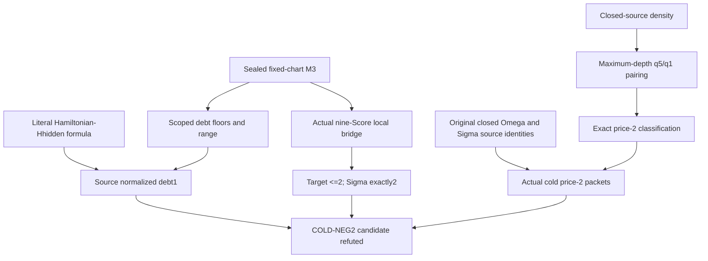

# Frozen original source and normalized COLD-NEG2 specification

Repository Dynamic-Optimality-Lab/splay-multiscale-transfer-liquidity.
Local branch coarse-double-branch, HEAD 8c378d49283b3738b18e7175886772a98025e4e9.
Tracked tree clean at entry and publication; substantial PRE-EXISTING
untracked research is preserved. Complete entry dirty-tree listing is
in entry.json. No fetch/pull/checkout/reset/stash/commit or overwrite.
Latest local DONOR06 and earlier source proofs are used, not an older
remote snapshot. All1455 inherited/local pins and the external IAGS
specification hash verify. New files exist only in this campaign folder.

Original model: any finite ordered present-key set, any common initial
BST diagonal, actual ordinary parent-first bottom-up splays. KEEP acts
in A and full B; DELETE acts only in A, never deletes a key. Erasing z
changes Kz to Dz and preserves the ENTIRE actual A trajectory. Costs are
a=ceil(dA/2), q=floor(dB/2) on KEEP, q0 on DELETE. A DOUBLE and terminal
ZIG each count one A StepEv; only DOUBLE contributes B q. The read-only
engine's depth+1 convenience pair costs are NOT used.

Domain: original reachable finite exactly labeled paired-closed histories
with six genuine KEEP keys. Full B core S is fixed,6<=|S|<=11. Natural
FULL macros end at genuine full KEEPs and retain all intervening actual
operations. Pair every core11 q5 with its actual forced q1 successor;
all others are singletons. w=2min(H,4)-Q, with H actual A StepEvs.
NEG2_CLASSIFICATION.md proves the exact two negative-two classes.

The actual cyclic most-recent-five distinct KEEP set determines chart
marks before/after each packet. At core11 its actual ancestor core is
exactly nine physical Scores; no choice of representative is allowed.
At core10 the established padding is S minus the omitted recent key.
Core9 is not silently excluded from the cost classification; a global
padding convention there remains outside the present counterproof.

Candidate EXACTLY as requested: D is the sealed original fixed-nine-Score
debt in[0,2]. On a Hamiltonian nine-Score B skeleton, Hhidden means NO
marked SECOND/THIRD path Score is visible at an authorized NONROOT alpha
point with kind0,isS=true,index that role. Set Dhat0 when Hhidden,
min(D,1) at other Hamiltonian states, and D elsewhere. The literal R
observation of marked role2 in both counterexamples makes Hhidden false.
No new safe maximum is combined with this formula. The fixed-chart
incoming-Hamiltonian q<=1 lemma is not applied to a changing-chart miss.

Target: for EVERY source-valid COLD packet w-2, Dhat_old0 and Dhat_new2,
equivalently residual0. This is now REFUTED—EXACT by actual closed source
members of both classes. No critical source prerequisite was unavailable.
Normalized fixed-chart preservation remains proved at its own scope.

The density audit needs nonempty V, present target x and the rooted
ancestor core. If x is already in C_V, all operands are in that core and
outside hangers are V-free. If x is outside, the first frame touching
the last core ancestor introduces at most x and its next outside child p;
deeper processed pieces are V-free. This is SET inclusion, not a cardinal
surrogate. First visits into a source subtree count labeled introductions
over a FULL period; no fixed-subtree dynamic assumption is used. This
establishes the sorted odd mask at core11 and necessary16 P-bit masks
at core10, not the dynamic realization of every such mask.

R1-R4 preserve original semantics, full closure, signed costs, actual IDs,
ownership, frozen graph/raw states/observables/solver/private scopes,
shared midpoint, matching-terminal, corrected h0 and Bank25=25. The
CURRENT Gate E explicitly authorizes bounded actual source replays;
it supersedes the older no-replay restriction only for these checks.
All cumulative resource caps remain. No universal graph/solver is built.

IAGS uses the inspected original specification section24: Freeze,
Inherit, Alter, Recurse, Create/New Lemma, Reconstruct, Close/Reopen.
IAGS_BOXES.md records the exact child implications and strategic status.
Research-quality rules in RESEARCH_RULES.md are distinct from the source
R1-R4 contract. Success here is candidate elimination, not positive CD
coverage. Existing source receipts and unused reservations are unchanged.

## Inspected dependency ledger

| Exact repository path | Status | Inspection/reuse attribute | SHA256 |
|---|---|---|---|
| `DO_RESEARCH_REBOOT/ORIGINAL_PIPELINE.md` | SOURCE DEFINITION | full definitions inspected; historical OPEN status not used to overwrite sealed later CD5 | `3804b3bd5beb6fd2bbddcc7ac8d69f1a7d21a39a7fbd33c5fb397cd939eb896a` |
| `DO_RESEARCH_REBOOT/RESEARCH_RULES.md` | SOURCE DEFINITION | full permanent rules inspected | `c6b35f746f107ad8a1c226aefdb2b43711a4982fd9717fe513d7080f25d299bc` |
| `DO_RESEARCH_REBOOT/CD5_BASE01/CD5_PROOF.md` | PROVED—UNIVERSAL at support<=5 | full proof inspected, leaf theorems reused | `6380c55270c8c52505e2726e27a8fee734cac9812f39271b608cc282b34e88be` |
| `DO_RESEARCH_REBOOT/M3_XFER21/FULL_M3_PROOF.md` | PROVED—UNIVERSAL frozen M3 | formula refreshed; complete proof previously inspected and reused | `c54eb065947495c890adc945e3a2856218e6f1536728545f9d4fc3500c92b2c3` |
| `DO_RESEARCH_REBOOT/M3_XFER16/debt_definition.json` | PROVED—RESTRICTED ceiling and SOURCE DEFINITION | literal sole downward ceiling inspected; no global Lambda floor assumed | `66ea005ea09d5f69b30f7518007e2d357956618f60bd6ce9106ba5a9e6782958` |
| `DO_RESEARCH_REBOOT/M3_XFER17/debt_definition.json` | PROVED marked-root normalization | proper-marked predicate/formula inspected | `d9cbf8d29ca90cd6864f281bb4ab2184d359839d7f9e122cb529e5a74670ca5b` |
| `DO_RESEARCH_REBOOT/M3_XFER18/debt_definition.json` | PROVED current debt augmentation | explicit max formula inspected | `21ff41f3dd0fe71cf6c774e3815a09fd0e12fb608913bd10ffe60b0d4192cf00` |
| `DO_RESEARCH_REBOOT/M3_XFER19/STEP4_CERTIFICATE.json` | PROVED Step4 certificate | formula and accepted clause guards inspected; completed checks not replayed | `b025aac2978e98df35e4a646de0cf49d0ace2e48341949ab235217e7248ea10f` |
| `DO_RESEARCH_REBOOT/M3_XFER21/audit_extremal.json` | PROVED accepted completion clauses via final seal | accepted4359-clause data reused; source generator inspected, not executed | `c45a988241e1cc18e2feb593d8e44067333bae1df23d02950393e4f20682d943` |
| `DO_RESEARCH_REBOOT/M3_LDR01/negative_run_census.json` | FINITE-EXACT frozen topology/psi facts | read-only facts reused; no regeneration | `b8d9c005a03cf4a40ec4728279117972c994b4f64dfdbdb8870bd58605066573` |
| `DO_RESEARCH_REBOOT/M3_H1F01/cheap_census.json` | FINITE-EXACT frozen depth/destination facts | read-only facts reused; no regeneration | `a36fc08df1301dabc954cc2149c398512ff85b22a21a12037d76aa702634b93f` |
| `DO_RESEARCH_REBOOT/SE03_STEP1_FUND01/AUXILIARY_FUNDING_THEOREM.md` | PROVED—UNIVERSAL auxiliary domain | full physical allocation proof inspected | `134a17f13e05e2052a29733a83b556875d466fab90e415c11d041658ffab03e3` |
| `DO_RESEARCH_REBOOT/SE03_STEP1_FUND01/SOURCE_IDS_AND_CYCLIC_CUT.md` | PROVED period transport | full proof inspected | `862e3c60dda74a6cb3d17315d08857de710cae4ea6baaa921a29c739b1efb29e` |
| `DO_RESEARCH_REBOOT/SE03_STEP2_REPAY01/CLOSED_CORE_SUBTREE_DENSITY.md` | PROVED—UNIVERSAL actual closed B sources | set-growth, label counting and prefix proof inspected | `5ce1bece8c4aa6fc273de5198d616a6c3905a4785f299f843da92e99d3f7f0e0` |
| `DO_RESEARCH_REBOOT/SE03_STEP2_REPAY01/MAXIMUM_DEPTH_SUCCESSOR_REPAYMENT.md` | PROVED maximum-depth successor | full fan and disjoint-packet proof inspected | `7bec09c38aede39370c4400637bdc1c6f196aa39bb0c4732e7b9102ee23c4a40` |
| `DO_RESEARCH_REBOOT/SE03_STEP2_REPAY01/UNIFORM_RANGE_OBSTRUCTION.md` | PROVED source family/necessary range | full source W_r,H_r and Gamma proof inspected | `3a8b41b4b2905d8f8baf80e14e6b5bfa1aefd65fa996cf5af04e8f04ebb6e222` |
| `DO_RESEARCH_REBOOT/SE03_STEP2_REPAY01/PAIRED_RANGE_TWO_TARGET.md` | PROVED partition; proposed D OPEN | exact partition and modified Gamma witness inspected | `7f03315b64aa5f11db54e062a306cf4a9d8b6b04ccc1c62b225cd090e9a4ca79` |
| `DO_RESEARCH_REBOOT/SE03_STEP2_REPAY02/CHECKPOINT.md` | OPEN Step2; prior candidate REFUTED | full current local checkpoint inspected | `5d9a94da5e33093d8d600747a284fa36271ac5cade4fcb8aed67798601a16a59` |
| `DO_RESEARCH_REBOOT/SE03_STEP2_REPAY02/NINE_SCORE_SOURCE_BRIDGE.md` | PROVED—UNIVERSAL fixed actual nine Scores | full source embedding proof inspected | `c2b768772f50901e60c2b98f8ba501249bec2f663dc0c613e920213814fd8183` |
| `DO_RESEARCH_REBOOT/SE03_STEP2_REPAY02/COLD_EXCHANGE_IDENTITY.md` | PROVED identity; sign comparison OPEN | full signed source interface inspected, -1 retained | `7fd9da81b7970f5fecdc76de899baf6921e0d8bb2ecf12a37dbe0525e695d7ed` |
| `DO_RESEARCH_REBOOT/SE03_STEP2_REPAY02/RECENT_SUPPORT_COVER.md` | PROVED actual recent-key cover | full source proof inspected | `916f4cae1f0431a1e502b47fa8757f8e465a7388de042e8c37a411eb2b39fc69` |
| `DO_RESEARCH_REBOOT/SE03_STEP2_REPAY02/RETAINED_GAP_RESERVATION.md` | PROVED—UNIVERSAL auxiliary reservation domain | full proof inspected; gE not identified with fE | `736dcf6b1d8e8789b0a7b4d0c3a6957f5b53bc3dfbe91d6a91258b2c24ef567a` |
| `DO_RESEARCH_REBOOT/SE03_STEP2_REPAY02/HAMILTONIAN_DEBT_NORMALIZATION.md` | PROVED fixed-chart preservation; changing-chart candidate now REFUTED | full exact Hhidden/proof inspected | `6e7d61fd367c4dad85ebe7b7979624a90a155f7c38da99233e8e5de2c48ef1e9` |
| `DO_RESEARCH_REBOOT/SE03_STEP2_REPAY02/RAY_NORMALIZATION_AND_OBSTRUCTION.md` | PROVED fixed-chart ray ceiling and actual Omega obstruction | full source/debt proof inspected; old/new normalization distinguished | `aa6201b8dde7b355d53cf3ca2ff1c0495dc48a2c25c723f4c36125cfd0683d2a` |
| `DO_RESEARCH_REBOOT/SE03_STEP2_REPAY02/PERSISTENT_OMEGA_EXTENSION.md` | PROVED—RESTRICTED actual arbitrary-fringe family | full closure/recurrence/old receipt proof inspected | `d56fddd827c34d2be4e129edf1de0bae9c140260c4f4498c3a6af40a026322b3` |
| `DO_RESEARCH_REBOOT/SE03_STEP2_DONOR05/CLOSED_MAXIMAL_SAME_SIDE.md` | PROVED actual closed maximal sources | full source mass/persistence proof inspected; not a frozen graph filter | `ad1655f40193be2383e2338ee7cebf8ebe4cfccd294266945a9fa690eadaceba` |
| `DO_RESEARCH_REBOOT/SE03_STEP2_DONOR06/CHECKPOINT.md` | OPEN Step2, Step3 and Universal CD | latest local status inspected, not replaced by remote history | `8a9872a7f28a6be0e58a05308d789224e0c29b5e6f5bdff8b072731d32859fd6` |
| `python/independent/splay.py` | SOURCE DEFINITION | full source inspected; trace used, depth+1 pair cost functions NOT used | `3a178c131c70c08419f18d1035dfb32beb5aa781673098ffbd4a5293f91d2f01` |
| `python/independent/pair.py` | SOURCE DEFINITION | full source inspected; trace used, depth+1 pair cost functions NOT used | `cb1e6abf8498d8d2631a258780c24e4a47c00bbd2ee4bf74561c8dc2ce1a1f88` |

External original IAGS specification: `C:\Users\Saif malik\.codex\attachments\0202b78f-c0f4-4eb9-9158-8848d5ed842e\Pasted text.txt`,
SHA256 `0efdb745ef51a8a282e7c99dcacb05b77d199039012c8b6f0e8c4e21bb1563bd`. Only its declared sections
are used. Source precedence and prior corrected status distinctions remain.

## Acyclic dependency graph

There is no dependency on CD6, Universal CD, desired donor cardinality,
unproved chart comparison or the full Step2 conclusion.
