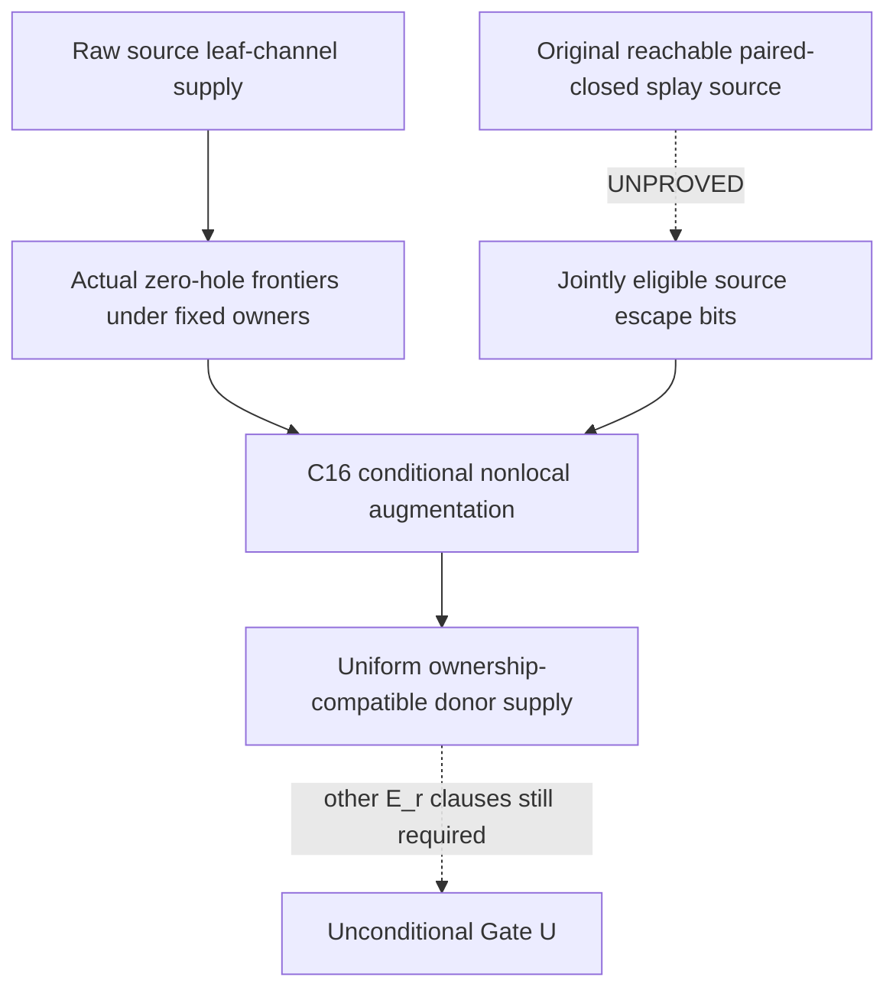

# First mathematical dependency output

Raw physical leaf channels (C15; source checks complete, final integrity
seal pending) give an injective partial comparison h_Lambda. Original
fixed owners a turn some deep-root walks into paths ending at ordinary
undefined comparison demands. C16 classifies natural zero holes and
derives conditional augmentation/global nonoverlap, all audit-pending.

The missing implication is SRC -> ESC for EVERY legitimate residual
component collection, with simultaneous distinct physical supply and
the original eligibility/storage/period guards. Neither conditional
augmentation nor a raw supply count proves that implication. The source
and ownership transitions are distinct relations; no projected graph
path is silently treated as a realizable new splay history.

The C17 primary theorem is not weakened to the known reset family.
The first internal source attack seeks actual PREPARATION supply in the
already recorded two-component history, then identifies precisely the
additional source statement needed for arbitrary histories.
